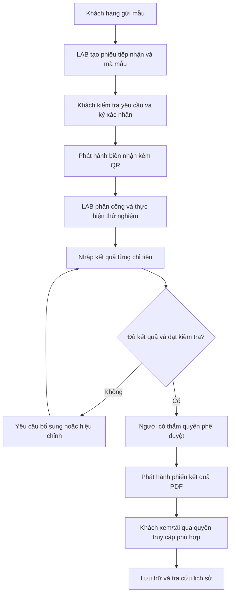
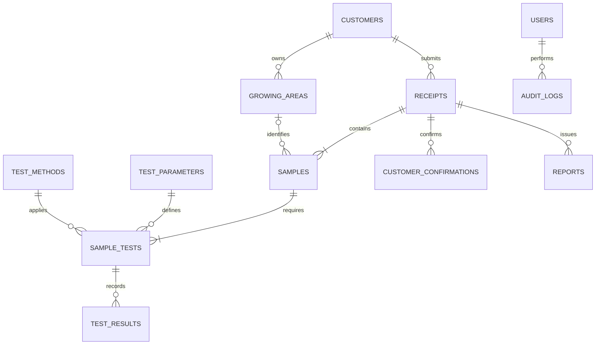
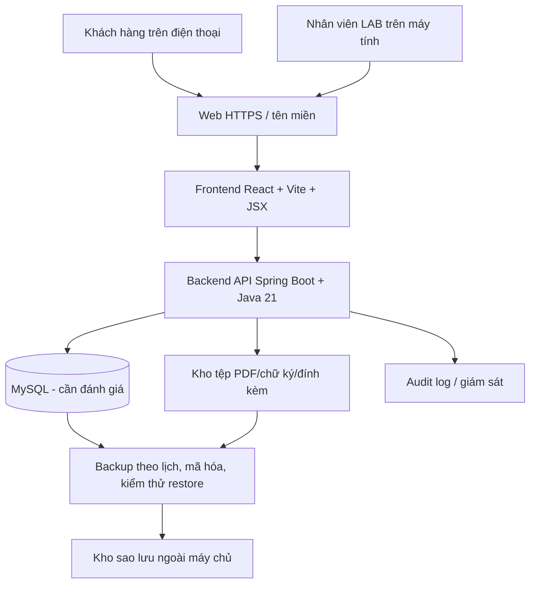

# CFC LAB MANAGEMENT 2026 — KẾ HOẠCH VÀ ĐẶC TẢ SƠ BỘ

**Tên dự án:** CFC Lab Management – Hệ thống quản lý mẫu thử nghiệm và tra cứu kết quả trực tuyến  
**Phiên bản tài liệu:** 1.4 – Cập nhật trạng thái đến biên bản thử nghiệm và kế hoạch phát hành kết quả
**Ngày lập:** 11/11/2026  
**Đơn vị đề xuất:** Bộ phận CNTT/AI & Automation (đề xuất)  
**Đơn vị nghiệp vụ phối hợp:** Phòng LAB, bộ phận quản lý chất lượng và các đơn vị liên quan  
**Trạng thái:** Đang triển khai theo vertical slice; phiếu 3 đã chạy, phiếu 4 trở đi còn cần LAB xác nhận
**Tài liệu tham khảo:** Video mẫu CFC Lab (~49 giây) do người đề xuất cung cấp; [video YouTube Shorts](https://www.youtube.com/shorts/MxDb3vp0pVE).

> **Lưu ý về mức độ xác thực:** Các màn hình, ví dụ dữ liệu và luồng thể hiện trong video là **tài liệu tham khảo sản phẩm**. Quy trình nội bộ, mẫu biểu, thẩm quyền phê duyệt, hạ tầng đang sử dụng và cơ chế phát hành kết quả thực tế của LAB **chưa được khảo sát/xác nhận**. Các thời hạn, KPI, công nghệ và yêu cầu dưới đây là **đề xuất sơ bộ**, cần thống nhất trước khi khởi động triển khai chính thức.

> **Addendum Giai đoạn 0 (12/11/2026):** Tài liệu này được đối chiếu với yêu cầu khởi động mới. Định hướng kỹ thuật chính để đánh giá tiếp là Java 21 LTS + Spring Boot stable + Spring Security/JPA/Validation/JWT ở backend, React + Vite + JavaScript ES Modules/JSX ở frontend, và MySQL là phương án cơ sở dữ liệu cần đánh giá. Các phần cũ đề xuất Node.js/TypeScript/PostgreSQL không còn là lựa chọn mặc định; nội dung nghiệp vụ phù hợp vẫn được giữ, còn các tính năng nâng cao chuyển sang tương lai hoặc cần xác nhận. Chưa có source code mới trong Giai đoạn 0.

> **Addendum nghiệp vụ 2 (12/11/2026):** Đã đối chiếu các biểu mẫu `3. Phiếu tiếp nhận và bàn giao mẫu.docx`, `4.Phieu chuyen mau.docx`, `5.Bien_ban_thu_nghiem.docx`, tài liệu `CFC14Quy trình mã hóa mẫu trái cây.doc` và màn hình tại giây 29 của `ư.mp4`. Quy trình cốt lõi được chốt để thiết kế hệ thống là **tiếp nhận → mã hóa → chuyển mẫu → thử nghiệm → kiểm tra/duyệt → phát hành PDF → khách tra cứu**. Các điểm chưa mô tả trong tài liệu vẫn được đánh dấu là câu hỏi cần LAB xác nhận, không tự suy diễn.

> **Addendum triển khai 3 (13/11/2026):** Đã có runtime Spring Boot/React/MySQL cho login email, session/CSRF, quản lý nhân viên Admin-only và vertical slice phiếu tiếp nhận số 3. Hệ thống đã lưu customer/receipt/sample/attachment, sinh mã CFC-TN-14 và được smoke-test bằng Playwright với MySQL. Giai đoạn kế tiếp là phiếu chuyển mẫu số 4 và custody; biên bản số 5, phát hành PDF và tra cứu khách chưa triển khai. Snapshot kỹ thuật ngắn nằm tại `docs/ai/CONTEXT.md`.

> **Addendum triển khai 4 (13/11/2026):** Đã hoàn thành vertical slice phiếu chuyển mẫu số 4 và biên bản thử nghiệm số 5: giao/nhận hoặc từ chối mẫu, thiết bị, hóa chất, đường chuẩn/công thức, QC, raw data, submit và kiểm tra/trả lại; trạng thái mẫu được đồng bộ đến `TEST_REVIEWED`. Giao diện quản trị đã chuyển sang tone sáng CFC, dùng logo trong `guideline-assets`, sidebar cố định theo viewport, mobile drawer và footer liên kết website CFC. Giai đoạn kế tiếp là duyệt/phát hành PDF có version/checksum, sau đó mới mở tra cứu khách.

> **Addendum báo cáo hiện hành 5 (13/11/2026):** Ranh giới runtime hiện tại dừng ở biên bản `TEST_REVIEWED`; chưa có bảng/API `result_releases`, PDF phát hành, thu hồi/đính chính hoặc cổng tra cứu khách. Dashboard quản trị hiện là giao diện mẫu với số liệu hard-code, không phải báo cáo vận hành. Responsive Admin UI đã được chuẩn hóa cho 390/1024/1440/2560px. Gate đầu tiên của Giai đoạn 5 là chặn người phân tích tự kiểm tra/tự phát hành, sau đó mới triển khai snapshot kết quả, version PDF và checksum bất biến. Báo cáo chi tiết và thứ tự công việc nằm tại `plans/CURRENT.md`.

### Quy trình nghiệp vụ đã xác nhận

1. **Tiếp nhận:** người giao mang mẫu sầu riêng và phiếu giấy theo biểu mẫu 3; nhân viên tiếp nhận kiểm tra thông tin, tình trạng, bao bì/niêm phong, vận chuyển/bảo quản, chỉ tiêu và thời hạn.
2. **Lập hồ sơ số:** nhân viên lưu bản scan/chụp phiếu giấy, nhập hồ sơ trên hệ thống, ghi người giao/người nhận/thời điểm và quyết định chấp nhận, chấp nhận có điều kiện hoặc từ chối.
3. **Mã hóa mẫu:** hệ thống sinh mã duy nhất theo CFC-TN-14, không chứa thông tin nhạy cảm và không đổi trong suốt vòng đời mẫu. Mã mẫu chuẩn gồm `SOURCE-PRODUCT-DDMMYYYY-SEQUENCE` (ví dụ `CT001-SR-23092026-001`); phần nền dùng hậu tố `-V` (vỏ) hoặc `-R` (ruột/thịt). Mẫu QC dùng hậu tố riêng như `-BL`, `-SP`, `-D`.
4. **Chuyển mẫu lên phòng KCS/PTN:** nhân viên lập phiếu chuyển mẫu theo biểu mẫu 4, liên kết các mã mẫu, khối lượng, số lượng, tình trạng, chỉ tiêu, phương pháp, ngày chuyển, hạn trả kết quả và lưu/hoàn mẫu.
5. **Thử nghiệm:** phòng phân tích lập biên bản thử nghiệm theo biểu mẫu 5; lưu người phân tích, người kiểm tra, thiết bị/serial/calibration, hóa chất, đường chuẩn, QC, raw data, kết quả và độ lệch.
6. **Phê duyệt và phát hành:** kết quả phải qua kiểm tra/duyệt trước khi công bố. Phiếu kết quả có phiên bản, người duyệt, thời điểm phát hành và PDF bất biến logic.
7. **Khách tra cứu:** khách nhập mã phiếu/mã mẫu và phần đuôi số điện thoại theo chính sách được duyệt. Sau khi xác thực, khách xem tiến độ, thông tin được phép công bố, vùng trồng/lịch sử liên quan và tải phiếu PDF kết quả. Màn hình tham chiếu tại giây 29 thể hiện bước “Có kết quả — tải PDF”, kết quả `KPH` và phần mở rộng “Xem phương pháp và chi tiết”.

**Hai kênh tiếp nhận:** hệ thống phải hỗ trợ hồ sơ đi từ phiếu giấy (đã xác nhận) và chừa `intake_channel` cho kênh thứ hai; kênh thứ hai, quy tắc bắt buộc giấy gốc và ai được nhập thay cần LAB xác nhận trước khi xây dựng giao diện cuối.

**Không công bố sớm:** dữ liệu thử nghiệm, kết quả nháp, raw data, thông tin QC và lỗi nội bộ không được đưa vào tra cứu khách hàng. Chỉ kết quả đã duyệt/phát hành mới được hiển thị/tải xuống.

---

## 1. TÓM TẮT DÀNH CHO LÃNH ĐẠO

Đề xuất xây dựng **CFC Lab Management** nhằm số hóa quy trình tiếp nhận mẫu, xác nhận yêu cầu thử nghiệm, theo dõi trạng thái xử lý và trả kết quả trực tuyến. Khi khách hàng gửi mẫu, hệ thống tạo **phiếu nhận mẫu có mã QR**; khách có thể **ký xác nhận trên điện thoại**, **quét QR xem tiến độ**, **xem kết quả đã được duyệt**, **tải phiếu PDF** và **tra cứu lịch sử kiểm nghiệm gắn với mã vùng trồng**.

Ngoài giao diện khách hàng giống video tham khảo, dự án phải có **cổng quản trị dành cho LAB** để tạo mẫu, quản lý chỉ tiêu, nhập kết quả, xét duyệt, phát hành báo cáo, phân quyền và lưu nhật ký thao tác. Hệ thống được phát triển theo hướng quản lý thông tin phòng thí nghiệm (LIMS) ở mức phù hợp với quy mô sử dụng, **không mặc định là LIMS hoàn chỉnh hoặc được công nhận theo tiêu chuẩn chuyên ngành**.

### 1.1. Giá trị dự kiến

- **Đối với khách hàng:** theo dõi mẫu 24/7, giảm việc hỏi tiến độ qua điện thoại, nhận kết quả thuận tiện, có lịch sử theo vùng trồng.
- **Đối với LAB:** thống nhất dữ liệu mẫu và chỉ tiêu, giảm phiếu giấy và nhập lại thông tin, kiểm soát các bước duyệt/phát hành.
- **Đối với quản lý:** có dashboard về mẫu đang xử lý, mẫu trễ hạn, chỉ tiêu chờ kết quả và thời gian hoàn thành.
- **Đối với hệ thống CNTT:** quản lý tập trung, kiểm soát quyền truy cập, sao lưu, theo dõi lỗi và có khả năng mở rộng.

### 1.2. Đề xuất quyết định trước mắt

1. Phê duyệt **khảo sát nghiệp vụ và thiết kế MVP** (chưa đồng nghĩa phê duyệt toàn bộ tính năng nâng cao).
2. Chỉ định **đầu mối nghiệp vụ LAB** có quyền xác nhận quy trình và mẫu biểu.
3. Thống nhất **cơ chế duyệt/phát hành kết quả** và quy định khách hàng được xem loại dữ liệu nào.
4. Cho phép kiểm tra khả năng vận hành máy Lab Windows, kết nối mạng, tên miền, sao lưu và mức độ sẵn sàng của UPS.
5. Sau giai đoạn khảo sát, chốt phạm vi, kế hoạch thời gian, dự toán và tiêu chí nghiệm thu.

---

## 2. CƠ SỞ ĐỀ XUẤT VÀ BÀI TOÁN NGHIỆP VỤ

### 2.1. Những tính năng *quan sát được* trong video

| STT | Tính năng trong video | Mô tả quan sát | Khả năng đưa vào dự án |
|---|---|---|---|
| 01 | Ký xác nhận online | Khách đọc phiếu yêu cầu, chọn các điều khoản, ký trực tiếp trên điện thoại; lưu người ký và thời điểm | Có, sau khi LAB xác nhận mẫu biểu/quy trình |
| 02 | QR trên biên nhận | Mỗi biên nhận có QR dẫn đến trang theo dõi mẫu | Ưu tiên MVP |
| 03 | Theo dõi ba bước | Đã nhận mẫu → Đang thử nghiệm → Có kết quả; có số chỉ tiêu hoàn thành, ví dụ 2/3 | Ưu tiên MVP, bổ sung trạng thái nội bộ |
| 04 | Xem kết quả và tải PDF | Khách xem chỉ tiêu, đơn vị, phương pháp, nhận xét và tải phiếu PDF | Ưu tiên MVP sau khi có cơ chế duyệt |
| 05 | Lịch sử theo vùng trồng | Kết quả đất và nông sản được liên kết theo mã vùng trồng, lưu nhiều lần theo thời gian | Giai đoạn mở rộng hoặc MVP nếu dữ liệu đã sẵn sàng |
| 06 | Tra cứu khi mất biên nhận | Nhập mã phiếu và bốn số cuối điện thoại | Cần thiết kế lại lớp xác thực trước khi triển khai thật |

**Chi tiết đáng chú ý:** Video còn hiển thị các lựa chọn trên phiếu như *cách kết luận kết quả, đồng ý/không đồng ý thầu phụ, xử lý mẫu sau thử nghiệm*. Đây là trường nghiệp vụ cần lấy ý kiến LAB chứ không thể tự động dùng nguyên văn.

### 2.2. Vấn đề cần khảo sát để xác nhận

Các điểm sau là **giả thuyết bài toán**, chưa khẳng định đang xảy ra tại LAB:

| Vấn đề có thể tồn tại | Tác động | Hướng giải quyết |
|---|---|---|
| Khách phải ký/xác nhận trên giấy | Mất thời gian, khó truy xuất | Phiếu điện tử kèm bằng chứng xác nhận |
| Khách thường gọi hỏi tiến độ | Tốn thời gian nhân viên | QR tra cứu tiến độ tự phục vụ |
| Dữ liệu nằm ở nhiều file hoặc sổ | Dễ chồng chéo, khó tổng hợp | Cơ sở dữ liệu tập trung |
| Một mẫu có nhiều chỉ tiêu khác nhau | Khó theo dõi mức độ hoàn tất | Trạng thái theo từng chỉ tiêu |
| Kết quả PDF tách rời thông tin mẫu | Khó tra cứu, đối chiếu | Liên kết mẫu – chỉ tiêu – kết quả – phiếu phát hành |
| Khó so sánh nhiều lần thử nghiệm ở một vùng trồng | Không khai thác được xu hướng dữ liệu | Lịch sử theo mã vùng trồng và thời gian |
| Không rõ ai sửa hoặc phát hành kết quả | Rủi ro sai lệch dữ liệu | Phân quyền và nhật ký kiểm toán |

### 2.3. Mục tiêu dự án

- Tập trung thông tin từ **tiếp nhận mẫu đến phát hành kết quả** trên một hệ thống.
- Mỗi phiếu có **mã định danh duy nhất**; mỗi mẫu có **mã mẫu riêng**; QR trỏ đúng phiếu được phép theo dõi.
- Khách hàng theo dõi tình trạng mẫu bằng trình duyệt điện thoại, không bắt buộc cài ứng dụng.
- Kết quả chỉ được công bố ra bên ngoài khi **đủ điều kiện và được người có thẩm quyền duyệt**.
- Lưu dữ liệu theo khách hàng, mẫu, chỉ tiêu và (khi có) mã vùng trồng.
- Có biện pháp bảo vệ dữ liệu, sao lưu/khôi phục, nhật ký thao tác và kế hoạch vận hành.

---

## 3. PHẠM VI VÀ THỨ TỰ ƯU TIÊN

### 3.1. MVP – Phiên bản vận hành đầu tiên

1. Đăng nhập và phân quyền nhân viên LAB/quản lý.
2. Quản lý danh mục khách hàng, loại mẫu, chỉ tiêu thử nghiệm và phương pháp.
3. Tạo phiếu tiếp nhận; khai báo một hoặc nhiều mẫu và các chỉ tiêu yêu cầu.
4. Sinh mã phiếu, mã mẫu và QR trên phiếu/biên nhận.
5. Tạo trang xác nhận yêu cầu thử nghiệm, ghi nhận nội dung đồng ý và chữ ký vẽ (nếu quy trình cho phép).
6. Theo dõi tiến độ: tiếp nhận, đang thử nghiệm, chờ duyệt, đã phát hành; hiển thị cho khách theo ba bước đơn giản.
7. Nhập kết quả từng chỉ tiêu, thể hiện trạng thái chưa có/kết quả nháp/chờ duyệt.
8. Duyệt và phát hành phiếu kết quả PDF có phiên bản, thời điểm và người duyệt.
9. Trang tra cứu công khai có kiểm soát; tải PDF chỉ với quyền phù hợp.
10. Nhật ký thao tác, sao lưu và màn hình thống kê cơ bản.

### 3.2. Giai đoạn sau MVP (cần xác nhận ưu tiên)

- Lịch sử kiểm nghiệm theo mã vùng trồng, so sánh nhiều kỳ; biểu đồ xu hướng đất/nông sản.
- Nhập hàng loạt từ Excel; mapping dữ liệu từ hệ thống/phần mềm LAB hiện tại.
- Tự động gửi thông báo email/SMS/Zalo theo điều kiện được chấp thuận.
- Dashboard nâng cao: thời gian xử lý theo từng loại mẫu/chỉ tiêu, tỷ lệ đúng hạn, chất lượng dịch vụ.
- Quản lý lô mẫu, lưu mẫu sau thử, biên bản bàn giao, công việc nội bộ.
- Kết nối trực tiếp thiết bị phân tích hoặc hệ thống chuyên dụng nếu có API/giao thức phù hợp.

### 3.3. Ngoài phạm vi ban đầu

- Tự động vận hành hay điều khiển máy móc thí nghiệm.
- Đưa ra kết luận chất lượng không có chuyên môn/phê duyệt của LAB.
- Thay thế hoàn toàn quy trình quản lý chất lượng, hệ thống kiểm soát thiết bị hoặc hồ sơ chuyên ngành hiện có.
- Cam kết chữ ký vẽ tay là chữ ký số có chứng thư hoặc có giá trị pháp lý tương đương mà chưa được thẩm định.
- Công bố dữ liệu của mọi vùng trồng cho bất kỳ ai có mã vùng trồng.

---

## 4. ĐỐI TƯỢNG SỬ DỤNG VÀ PHÂN QUYỀN

| Vai trò | Quyền dự kiến |
|---|---|
| Khách hàng | Xem thông tin phiếu được cấp quyền, xác nhận yêu cầu, theo dõi trạng thái, xem/tải kết quả đã phát hành của mình |
| Nhân viên tiếp nhận | Tạo/sửa thông tin trước khóa, lập phiếu, thêm mẫu, in biên nhận, gửi link ký |
| Kỹ thuật viên LAB | Xem mẫu được phân công, nhập kết quả nháp, đính kèm bằng chứng/phương pháp |
| Người kiểm tra/duyệt | Rà soát kết quả, trả lại để sửa, phê duyệt, cho phép phát hành theo thẩm quyền |
| Trưởng LAB/Quản lý | Xem dashboard, giám sát tiến độ, phê duyệt theo phân cấp, xuất báo cáo quản trị |
| Quản trị hệ thống | Quản lý tài khoản, cấu hình kỹ thuật, backup/restore, logs; không tự động có quyền chuyên môn để duyệt kết quả |

**Nguyên tắc:** Người nhập liệu không mặc định tự duyệt nội dung mình vừa nhập. Hệ thống nên tách quyền kỹ thuật và quyền phê duyệt chuyên môn.

---

## 5. QUY TRÌNH NGHIỆP VỤ ĐỀ XUẤT (TO-BE)

### 5.1. Luồng chuẩn

### 5.2. Trạng thái quản lý

**Trạng thái nội bộ đề nghị:**

- `DRAFT` – Phiếu nháp.
- `AWAITING_CUSTOMER_CONFIRMATION` – Chờ khách xác nhận.
- `RECEIVED` – Đã nhận mẫu.
- `IN_TESTING` – Đang thử nghiệm.
- `AWAITING_REVIEW` – Chờ kiểm tra/duyệt.
- `APPROVED` – Đã duyệt, chờ phát hành.
- `RELEASED` – Đã phát hành kết quả.
- `CANCELLED` – Hủy theo quy trình có ghi lý do.
- `ON_HOLD` – Tạm dừng do thiếu thông tin/mẫu không đạt điều kiện.

**Trạng thái hiển thị cho khách:** **(1) Đã nhận mẫu → (2) Đang thử nghiệm → (3) Có kết quả**. Không hiển thị chỉ tiêu nháp hoặc lỗi nội bộ khi chưa được duyệt công bố.

**Theo từng chỉ tiêu:** `PENDING` → `IN_PROGRESS` → `DRAFT_RESULT` → `REVIEWED`. Có thể có `NOT_PERFORMED`, `RETEST_REQUIRED` và lý do kèm theo.

**Quy tắc bắt buộc:** Nếu một mẫu có 3 chỉ tiêu và mới hoàn tất 2 chỉ tiêu, hệ thống có thể ghi nhận **2/3 đã có dữ liệu nội bộ**, nhưng không mặc định tiết lộ hai kết quả này cho khách trước khi duyệt. Nếu có phát hành từng phần, LAB phải phê duyệt quy tắc đó riêng.

### 5.3. Tình huống ngoại lệ phải có xử lý

- Khách nhập sai thông tin hoặc muốn chỉnh yêu cầu sau khi ký.
- LAB từ chối mẫu không phù hợp hoặc khách hủy yêu cầu.
- Mẫu thất lạc, hỏng, phải thử lại hoặc gửi thầu phụ.
- Chỉ tiêu không xác định được, kết quả **KPH / dưới LOD**; không quy đổi thành số 0.
- Kết quả bị trả lại để sửa trước khi phát hành.
- Phiếu đã phát hành cần đính chính: tạo **phiên bản mới**, có lý do, người duyệt và dấu vết bản cũ.
- Khách mất biên nhận hoặc không còn quyền truy cập đường dẫn.
- Mạng/điện/server gián đoạn khi đang ký hoặc nhập liệu.

---

## 6. ĐẶC TẢ CÁC PHÂN HỆ CHỨC NĂNG

### 6.1. Bảng yêu cầu chức năng

| Mã | Phân hệ / yêu cầu | Ưu tiên | Điều kiện nghiệm thu sơ bộ |
|---|---|---|---|
| FR-01 | Đăng nhập, phân quyền | P0 | Vai trò không được xem/sửa/duyệt vượt quyền |
| FR-02 | Danh mục khách hàng | P0 | Thêm, tìm, cập nhật, tránh trùng cơ bản |
| FR-03 | Danh mục loại mẫu/chỉ tiêu/phương pháp | P0 | LAB cấu hình không phải sửa code |
| FR-04 | Tạo phiếu tiếp nhận | P0 | Mã phiếu duy nhất, nhiều mẫu/phiếu nếu quy trình cần |
| FR-05 | Quản lý mã mẫu | P0 | Mỗi mẫu truy xuất được phiếu và danh sách chỉ tiêu |
| FR-06 | Biên nhận có QR | P0 | Quét mở đúng phiếu, URL HTTPS |
| FR-07 | Xác nhận và ký điện tử dạng vẽ | P0* | Lưu phiên bản nội dung xác nhận, người ký, thời điểm và bằng chứng kỹ thuật |
| FR-08 | Danh sách/chỉ định xử lý mẫu | P0 | Lọc theo trạng thái, hạn hẹn, loại mẫu |
| FR-09 | Nhập kết quả từng chỉ tiêu | P0 | Lưu đơn vị, phương pháp, giá trị hoặc kết quả định tính |
| FR-10 | Quy trình kiểm tra/duyệt | P0 | Chưa duyệt không được phát hành ra ngoài |
| FR-11 | Phát hành báo cáo PDF | P0 | PDF đúng mẫu biểu, có phiên bản, người duyệt, ngày phát hành |
| FR-12 | Khách theo dõi trạng thái | P0 | Hiển thị 3 bước và thời gian cập nhật hợp lệ |
| FR-13 | Tra cứu phiếu/kết quả có xác thực | P0 | Không thể thử hàng loạt mã và lấy dữ liệu người khác |
| FR-14 | Nhật ký hoạt động (audit log) | P0 | Truy vết thay đổi dữ liệu, duyệt và phát hành |
| FR-15 | Backup và phục hồi | P0 | Khôi phục thử một bản backup thành công |
| FR-16 | Quản lý vùng trồng | P1 | Liên kết mẫu với mã vùng trồng đúng chủ sở hữu |
| FR-17 | Lịch sử theo vùng trồng | P1 | Lọc theo thời gian, loại mẫu, chỉ tiêu |
| FR-18 | Dashboard tiến độ | P1 | Số mẫu mới/đang xử lý/trễ hạn/đã trả |
| FR-19 | Nhập dữ liệu từ Excel | P1 | Có mẫu cột, kiểm tra lỗi và báo cáo dòng bị lỗi |
| FR-20 | Thông báo tự động | P2 | Gửi theo sự kiện, không lộ thông tin nhạy cảm |
| FR-21 | Tích hợp thiết bị/phần mềm LAB | P2 | Có khảo sát khả năng kết nối và kiểm thử đối soát |
| FR-22 | So sánh chỉ tiêu nhiều kỳ | P2 | Biểu đồ dùng dữ liệu đã xác minh, ghi rõ đơn vị/phương pháp |

*P0 = phải có để vận hành; P1 = nên có; P2 = mở rộng. `FR-07` chỉ đưa vào vận hành chính thức sau khi LAB/pháp chế phê duyệt nội dung và cách xác nhận điện tử.*

### 6.2. Giao diện chính

**Khách hàng – giao diện ưu tiên điện thoại:**

1. Mở liên kết xác nhận yêu cầu thử nghiệm.
2. Xem thông tin khách, mã phiếu, danh sách mẫu, chỉ tiêu, phương pháp và các điều khoản.
3. Chọn phương án xử lý theo mẫu biểu đã được LAB phê duyệt; ký và xác nhận.
4. Quét QR trên biên nhận để xem 3 bước tiến độ.
5. Xem kết quả đã được phát hành; mở chi tiết từng chỉ tiêu; tải PDF.
6. Tra cứu lịch sử trong phạm vi dữ liệu khách hàng được phép xem.

**Nhân viên LAB – giao diện desktop:**

1. Dashboard tổng hợp công việc, cảnh báo mẫu sắp/quá hạn.
2. Danh sách phiếu và chi tiết từng mẫu.
3. Danh mục khách hàng, vùng trồng, loại mẫu, chỉ tiêu, phương pháp.
4. Form nhập kết quả với kiểm tra kiểu dữ liệu, đơn vị và trường bắt buộc.
5. Hàng chờ kiểm tra, duyệt, phát hành và đính chính.
6. Quản trị người dùng, phân quyền, log và tình trạng hệ thống.

### 6.3. Quy tắc xử lý dữ liệu chuyên môn

- Mỗi chỉ tiêu có thể có **kiểu kết quả khác nhau**: số, chuỗi định tính, giá trị dưới giới hạn phát hiện, không áp dụng, không thực hiện.
- Lưu riêng **giá trị đo, đơn vị đo, phương pháp, giới hạn phát hiện (nếu có), ngưỡng so sánh và cách kết luận**; không mặc định tất cả chỉ tiêu có chung ngưỡng.
- Cách hiển thị `KPH` và `LOD` phải do LAB quy định, không hiển thị `0` thay thế khi không phù hợp.
- Chỉ tiêu đo đất và nông sản có thể khác đơn vị/phương pháp; **không so sánh số liệu không tương thích**.
- Dữ liệu đã được duyệt/phát hành phải có cơ chế khóa, sửa bằng quy trình điều chỉnh có lịch sử.
- Tham số, giới hạn và nhận xét phải có phiên bản áp dụng tại thời điểm thử nghiệm/phát hành, tránh dùng cấu hình mới để diễn giải sai lịch sử.

---

## 7. THIẾT KẾ DỮ LIỆU DỰ KIẾN

### 7.1. Các bảng dữ liệu lõi

| Bảng | Trường thông tin quan trọng | Ghi chú |
|---|---|---|
| `users` | id, họ tên, email, trạng thái | Tài khoản nhân viên |
| `roles`, `user_roles` | vai trò, quyền | Quản lý truy cập |
| `customers` | mã khách, tên tổ chức/cá nhân, liên hệ | Quản lý dữ liệu cá nhân |
| `growing_areas` | mã vùng trồng, tên vùng, chủ sở hữu, địa điểm | Không phải mẫu nào cũng có vùng trồng |
| `receipts` | mã phiếu, khách hàng, ngày nhận, hạn hẹn, trạng thái | Một phiếu có thể có nhiều mẫu |
| `samples` | mã mẫu, mã phiếu, loại mẫu, mã vùng trồng, mô tả | Liên kết với phiếu |
| `test_parameters` | mã chỉ tiêu, tên, kiểu dữ liệu, đơn vị mặc định | Danh mục chuẩn |
| `test_methods` | mã phương pháp, tên, phiên bản | Theo quy định LAB |
| `sample_tests` | mẫu, chỉ tiêu, phương pháp, trạng thái, hạn hẹn | Mỗi mẫu có nhiều phép thử |
| `test_results` | kết quả, đơn vị, LOD, nhận xét, người nhập, thời điểm | Có lịch sử sửa/duyệt |
| `customer_confirmations` | người ký, phiên bản phiếu, nội dung đồng ý, chữ ký, thời điểm | Lưu bằng chứng xác nhận |
| `reports` | mã phiếu kết quả, trạng thái, phiên bản, người duyệt, file PDF | Bản đã phát hành là bất biến logic |
| `access_tokens` | mã định danh token, loại quyền, hết hạn, đã thu hồi | Không lưu token bí mật dưới dạng rõ nếu không cần |
| `audit_logs` | người thao tác, đối tượng, hành động, trước/sau, thời điểm | Theo chính sách bảo mật và lưu trữ |
| `attachments` | loại tài liệu, đường dẫn, hash, người tải lên | Quản lý file đính kèm |

### 7.2. Quan hệ dữ liệu ở mức khái quát

**Quy tắc định danh:** Mã phiếu, mã mẫu, mã kết quả và mã vùng trồng là các mã nghiệp vụ; database vẫn dùng khóa chính nội bộ riêng. QR không nên chứa ID tăng dần hoặc dữ liệu cá nhân ở dạng dễ đọc.

---

## 8. KIẾN TRÚC KỸ THUẬT ĐỀ XUẤT

### 8.1. Sơ đồ tổng thể

### 8.2. Công nghệ đề xuất

| Hạng mục | Lựa chọn đề xuất | Lý do |
|---|---|---|
| Frontend | React + Vite + JavaScript ES Modules/JSX, giao diện responsive | Phù hợp yêu cầu mới; không dùng TypeScript/TSX ở giai đoạn này |
| Backend | Java 21 LTS + Spring Boot stable, Spring Security, Spring Data JPA, Bean Validation, Maven ưu tiên | Phù hợp định hướng backend mới và package-by-feature |
| Cơ sở dữ liệu | MySQL là phương án chính cần đánh giá; PostgreSQL là phương án thay thế | Dữ liệu quan hệ, giao dịch, ràng buộc và truy vấn lịch sử; quyết định cuối cần khảo sát vận hành |
| PDF | Template HTML + bộ render PDF phía server | Quản lý mẫu phiếu, dấu/version, không phụ thuộc trình duyệt khách |
| QR | Mã truy cập ngẫu nhiên/đường dẫn an toàn | Hạn chế đoán mã, dễ thu hồi |
| Xác thực nội bộ | Tài khoản phân quyền, mật khẩu băm; MFA cho tài khoản quan trọng | Bảo vệ dữ liệu và quyền duyệt |
| Giám sát | Health check, cảnh báo lỗi, dung lượng, backup | Hỗ trợ vận hành ổn định |
| Quản lý mã nguồn | Git + môi trường kiểm thử riêng | Kiểm soát thay đổi, rollback |

**Lựa chọn cần xác nhận:** Java 21/Spring Boot là định hướng theo yêu cầu Giai đoạn 0, nhưng version Spring Boot cụ thể, hạ tầng chạy ứng dụng, database và khả năng vận hành vẫn phải được xác minh trước khi bootstrap. Việc máy Lab có Node.js không còn là căn cứ chọn backend.

### 8.3. Hai phương án triển khai

| Tiêu chí | Phương án A – Máy Lab Windows nội bộ | Phương án B – Hạ tầng cloud được quản lý |
|---|---|---|
| Ưu điểm | Tận dụng thiết bị sẵn có, chủ động vận hành LAN | Thuận tiện cấp HTTPS công khai, dễ mở rộng và tách môi trường |
| Phụ thuộc | Điện, Internet công ty, UPS, máy Windows luôn chạy | Phụ thuộc nhà cung cấp/dịch vụ Internet |
| Rủi ro chính | Điểm lỗi đơn; mất điện/mạng là khách ngoài không truy cập được | Chi phí định kỳ, cần chính sách lưu trữ và bảo mật phù hợp |
| Truy cập bên ngoài | Qua gateway/tunnel HTTPS được bảo vệ; **không mở trực tiếp database hoặc cổng quản trị ra Internet** | Qua tên miền + HTTPS và các chính sách bảo mật cloud |
| Đánh giá | Phù hợp thử nghiệm/pilot hoặc nếu có nhân sự vận hành | Nên ưu tiên khi web phục vụ khách hàng thường xuyên |

**Khuyến nghị:** Đầu tiên chạy môi trường DEV/UAT riêng. Chỉ lựa chọn sản xuất sau khảo sát số lượng truy cập, yêu cầu sẵn sàng, ngân sách và quy định bảo mật của doanh nghiệp. Không gộp máy Windows đang chạy thử với hệ thống chính thức nếu chưa đánh giá rủi ro.

### 8.4. Liên hệ với các đầu việc máy LAB đã được giao

| Đầu việc đang có | Vai trò trong kế hoạch | Ghi chú thực hiện |
|---|---|---|
| Cài Node.js LTS trên Windows | Nền tảng có thể chạy backend/app | Kiểm tra ứng dụng tương thích phiên bản LTS |
| Đặt IP tĩnh | Giữ địa chỉ LAN ổn định cho máy server | Ưu tiên **DHCP Reservation / Static Lease trên MikroTik** theo MAC; xác minh IP không trùng |
| Gắn UPS | Giảm rủi ro mất điện đột ngột | Nếu UPS hỗ trợ, cấu hình tự shutdown khi pin yếu |
| Tắt Sleep/Hibernate | Tránh ngừng dịch vụ khi không sử dụng máy | Kèm chính sách cập nhật Windows và tự khởi động dịch vụ |
| Google Drive Desktop trên máy Lab và Mac mini | Trao đổi tài liệu, lưu bản sao tài liệu/backup được thiết kế | **Không** đồng bộ trực tiếp thư mục dữ liệu sống của MySQL/PostgreSQL qua Google Drive |
| Thư mục sao lưu | Tập trung các bản sao lưu có phiên bản | Chỉ backup đã tạo nhất quán; mã hóa, kiểm soát quyền và kiểm thử phục hồi |

**Lưu ý mạng:** `192.168.1.x` là địa chỉ riêng trong LAN; QR muốn truy cập từ Internet phải dùng tên miền/HTTPS và thiết kế đường truy cập phù hợp. Máy Lab cần được kiểm tra CPU/RAM/SSD, thông số UPS, tốc độ Internet, IP mạng, tường lửa và chính sách vận hành trước khi chọn làm máy chủ sản xuất.

---

## 9. BẢO MẬT, QUYỀN RIÊNG TƯ VÀ TÍNH TOÀN VẸN KẾT QUẢ

1. **QR không phải “vé xem toàn bộ dữ liệu”:** link QR nên dùng token ngẫu nhiên đủ mạnh, giới hạn phạm vi thông tin, có cơ chế hết hạn/thu hồi khi cần. QR trên giấy có thể bị chụp lại.
2. **Tra cứu bằng mã phiếu + bốn số cuối điện thoại:** đây là điểm minh họa của video, **không đủ an toàn nếu là lớp bảo vệ duy nhất** cho báo cáo chứa thông tin nhạy cảm. Đề xuất bổ sung OTP, tài khoản, mã truy cập bí mật riêng hoặc xác thực phù hợp; giới hạn tốc độ và chống dò mã.
3. **Bảo vệ dữ liệu cá nhân:** thu thập tối thiểu, thông báo mục đích sử dụng, phân quyền theo khách/vùng trồng, quy định thời gian lưu, xử lý yêu cầu liên quan đến dữ liệu cá nhân và rà soát tuân thủ pháp luật áp dụng.
4. **Ký xác nhận:** lưu nội dung phiếu phiên bản được ký, thời điểm, thông tin người xác nhận, dữ liệu chữ ký vẽ và vết kiểm toán. Phải xác minh yêu cầu về hiệu lực pháp lý và thẩm quyền ký với đơn vị phụ trách; không quảng bá chữ ký vẽ như chữ ký số được chứng thực.
5. **Duyệt phát hành:** kết quả nháp không hiển thị cho khách; quyền duyệt tách khỏi quyền nhập; có lịch sử phê duyệt/từ chối.
6. **Đính chính kết quả:** không ghi đè âm thầm phiếu đã phát hành; dùng phiên bản mới, lý do thay đổi, người thực hiện và trạng thái bản cũ.
7. **Phân tách môi trường:** DEV/UAT dùng dữ liệu giả hoặc đã được ẩn danh; PROD lưu dữ liệu thực. Không sử dụng một cơ sở dữ liệu cho cả ba môi trường.
8. **An toàn server:** HTTPS, cập nhật hệ điều hành/gói phần mềm, đóng cổng không dùng, giới hạn truy cập admin, chống brute force, quản lý bí mật bằng biến môi trường hoặc kho bí mật; không lưu mật khẩu trong Git.
9. **Sao lưu theo quy tắc nhiều bản:** có bản sao ngoài máy chủ, bản định kỳ có phiên bản, kiểm tra file backup và **thử restore**; đồng bộ một chiều không thay thế backup.
10. **Nhật ký và cảnh báo:** ghi nhận đăng nhập bất thường, thay đổi quyền, dữ liệu kết quả, phát hành PDF, thất bại backup và tình trạng đầy ổ đĩa.

**Yêu cầu pháp lý/chuyên môn cần rà soát trước vận hành:** xử lý dữ liệu cá nhân, xác nhận điện tử, quyền sử dụng phiếu kết quả, quy tắc lưu hồ sơ phòng thí nghiệm và yêu cầu của hệ thống quản lý chất lượng đang áp dụng tại LAB (nếu có).

---

## 10. PHƯƠNG ÁN SAO LƯU VÀ VẬN HÀNH

### 10.1. Chính sách đề xuất để LAB/CNTT phê duyệt

| Chỉ tiêu | Mức đề xuất ban đầu | Cần xác nhận |
|---|---|---|
| Backup database | Mỗi ngày; tăng tần suất khi phát sinh dữ liệu lớn | Khối lượng dữ liệu và mức mất dữ liệu chấp nhận |
| Backup file PDF/chữ ký | Định kỳ có phiên bản, đồng bộ cùng metadata liên quan | Dung lượng và kỳ hạn lưu |
| RPO (mất dữ liệu tối đa) | Không quá 24 giờ | Có cần giảm xuống 1–4 giờ không? |
| RTO (thời gian khôi phục) | Trong 8 giờ làm việc | Yêu cầu hỗ trợ khách ngoài giờ |
| Bài kiểm tra restore | Ít nhất mỗi quý hoặc sau thay đổi lớn | Người phụ trách và nơi phục hồi |
| Giám sát | Tình trạng API, DB, ổ cứng, dịch vụ và backup | Công cụ cảnh báo tới ai |
| Thời gian lưu trữ | Theo chính sách LAB và yêu cầu áp dụng | Chưa tự đặt thời hạn pháp lý |

**Kịch bản phải thử:** mất điện, máy reboot, Internet ngắt, database lỗi, PDF không mở được, gửi nhầm đường link, khách quét QR đã thu hồi và rollback sau cập nhật.

---

## 11. KẾ HOẠCH TRIỂN KHAI DỰ KIẾN (12 TUẦN)

**Giả định nguồn lực:** 01 lập trình viên chính phụ trách web/backend, 01 đại diện LAB tham gia nghiệp vụ/UAT bán thời gian, 01 người có thẩm quyền duyệt biểu mẫu/kết quả, hỗ trợ CNTT hạ tầng khi cần. Nếu đồng thời phải làm phần mềm chuyên dụng, tích hợp máy hoặc yêu cầu ký điện tử có tiêu chuẩn riêng, tiến độ có thể kéo dài.

| Tuần | Công việc trọng tâm | Sản phẩm bàn giao / cổng kiểm soát |
|---|---|---|
| **W1** | Phỏng vấn LAB; thu phiếu nhận mẫu, mẫu trả kết quả, quy trình, danh mục chỉ tiêu; xem hiện trạng dữ liệu | Biên bản khảo sát và sơ đồ AS-IS |
| **W2** | Chốt TO-BE, phạm vi MVP, vai trò/phân quyền, màn hình mẫu, dữ liệu và điều kiện nghiệm thu | Tài liệu yêu cầu/thiết kế được LAB xác nhận (**Gate 1**) |
| **W3** | Thiết lập Git, môi trường DEV/UAT, database, đăng nhập, phân quyền | Nền tảng chạy được và kiểm thử quyền |
| **W4** | Khách hàng, loại mẫu, danh mục chỉ tiêu; tạo phiếu, mã mẫu | Luồng tiếp nhận mẫu nội bộ |
| **W5** | Trang xác nhận yêu cầu, lưu chữ ký, tạo biên nhận QR | Demo khách xác nhận và nhận QR |
| **W6** | Quản lý luồng xử lý, trạng thái từng chỉ tiêu, trang theo dõi 3 bước | Demo QR theo dõi, quyền truy cập an toàn |
| **W7** | Nhập kết quả, kiểm tra, trả lại, duyệt và khóa dữ liệu | Quy trình chuyên môn chạy end-to-end |
| **W8** | Mẫu báo cáo PDF, phát hành phiên bản, tra cứu/tải kết quả | Demo một mẫu từ tiếp nhận đến PDF (**Gate 2**) |
| **W9** | Nhật ký, dashboard cơ bản; vùng trồng/lịch sử ở mức tối thiểu nếu đã chốt thuộc MVP | Báo cáo quản trị; hoàn thiện use case |
| **W10** | Bảo mật, test chức năng, hiệu năng cơ bản, sao lưu/phục hồi, sửa lỗi | Báo cáo kiểm thử và danh sách lỗi tồn |
| **W11** | UAT với nhân viên LAB và dữ liệu thử/ẩn danh; đào tạo, xử lý góp ý | Biên bản UAT và xác nhận sẵn sàng (**Gate 3**) |
| **W12** | Cấu hình PROD, chuyển dữ liệu được phê duyệt, chạy pilot, nghiệm thu, bàn giao | Biên bản nghiệm thu và tài liệu vận hành (**Gate 4**) |

**Đề xuất cách phát hành:** chạy thử với một nhóm nhỏ và số lượng phiếu hạn chế trước; không chuyển toàn bộ quy trình thật sang hệ thống mới trong cùng một ngày nếu chưa kiểm chứng.

### 11.1. Các mốc phê duyệt bắt buộc

- **Gate 1 – Chốt yêu cầu:** LAB ký xác nhận phạm vi, mẫu biểu, phân quyền và quy trình duyệt.
- **Gate 2 – Chốt chức năng:** Demo luồng hoàn chỉnh và xác nhận các trường dữ liệu/phiếu PDF.
- **Gate 3 – Sẵn sàng triển khai:** UAT đạt, vấn đề bảo mật mức nghiêm trọng đã xử lý, có backup/restore và phương án hỗ trợ.
- **Gate 4 – Nghiệm thu:** LAB và CNTT ký biên bản, nhận tài liệu, tài khoản vận hành, kế hoạch bảo trì và đầu mối xử lý sự cố.

### 11.2. Ước tính công sức sơ bộ

| Nhóm công việc | Công sức ước tính (ngày công) |
|---|---:|
| Khảo sát, phân tích, đặc tả và UX | 8–12 |
| Backend, thiết kế database và phân quyền | 12–16 |
| Frontend LAB và khách hàng | 12–16 |
| Xác nhận online, QR, tracking | 8–12 |
| Duyệt, báo cáo PDF và lịch sử cơ bản | 10–15 |
| Test, UAT, triển khai, tài liệu, backup | 10–15 |
| **Tổng ước tính** | **60–86 ngày công** |

Số ngày công là **ước tính để lập kế hoạch**, chưa phải báo giá. Có thể vượt nếu phải làm mới toàn bộ quy trình, nhập nhiều dữ liệu lịch sử, tích hợp thiết bị, xử lý chữ ký số hoặc phát triển dashboard nâng cao.

---

## 12. DỰ TOÁN – CẤU PHẦN CHI PHÍ CẦN CHỐT

Hiện chưa đủ thông số để đưa ra số tiền đáng tin cậy. Đề xuất lập dự toán theo các nhóm sau, tránh tạo ấn tượng rằng các dịch vụ là miễn phí hoàn toàn:

| Nhóm chi phí | Thành phần | Nguyên tắc dự toán |
|---|---|---|
| Nhân sự phát triển | 60–86 ngày công, cộng dự phòng thay đổi | Đơn giá ngày công nội bộ/thuê ngoài do công ty xác nhận |
| Máy chủ / hạ tầng | PC Windows hiện có hoặc VPS/cloud, ổ đĩa, UPS | So sánh chi phí đầu tư, độ ổn định, bảo trì |
| Tên miền / SSL / truy cập Internet | Tên miền, DNS, HTTPS, tunnel/proxy nếu cần | Kiểm tra dịch vụ đã có để không mua trùng |
| Lưu trữ và backup | Dung lượng DB, bản PDF, dữ liệu chữ ký, nơi dự phòng | Dựa vào số mẫu/tháng, dung lượng trung bình và thời hạn lưu |
| Thông báo | SMS/OTP/Zalo/email nếu triển khai | Tính theo lượt giao dịch thực tế, phụ thuộc nhà cung cấp |
| Bảo mật và vận hành | Giám sát, cập nhật, restore test, hỗ trợ người dùng | Có người chịu trách nhiệm và lịch bảo trì |
| Dự phòng | Thay đổi biểu mẫu/quy trình, bổ sung kiểm thử | Đề xuất dự phòng 15–20% phần chi phí triển khai phù hợp |

**Công thức dự toán sơ bộ:** `Chi phí triển khai = ngày công × đơn giá được phê duyệt + hạ tầng/thiết bị + dịch vụ bắt buộc + dự phòng`.  
**Chi phí vận hành năm:** `tên miền + hosting/điện/mạng + lưu trữ/backup + dịch vụ thông báo + công bảo trì`.

### 12.1. Định hướng tiết kiệm

- Tận dụng mã nguồn mở và kỹ năng nội bộ, nhưng vẫn tính chi phí triển khai/vận hành.
- Tận dụng máy Lab Windows **cho thử nghiệm/pilot nếu đạt điều kiện**, không mặc định phù hợp làm server chính thức 24/7.
- Dùng tài khoản và dung lượng Google Drive do công ty phê duyệt; không đưa dữ liệu khách hàng lên tài khoản cá nhân khi chưa có quyền và chính sách.
- Ưu tiên bản MVP ổn định; các tích hợp/phân tích nâng cao triển khai sau khi có số liệu sử dụng.

---

## 13. RỦI RO VÀ BIỆN PHÁP KIỂM SOÁT

| Rủi ro | Mức ưu tiên | Biện pháp | Phụ trách đề xuất |
|---|---|---|---|
| Chưa thống nhất quy trình và mẫu biểu | Cao | Khảo sát, ký duyệt yêu cầu trước lập trình | LAB / Quản lý |
| Kết quả chưa duyệt bị lộ cho khách | Rất cao | RBAC, trạng thái phát hành, kiểm thử API, rà soát quyền | Dev / Người duyệt |
| Mã QR bị chia sẻ hoặc đoán trúng | Cao | Token ngẫu nhiên, giới hạn phạm vi/tuổi thọ, xác thực bổ sung | Dev / CNTT |
| Chữ ký vẽ không đáp ứng yêu cầu pháp lý | Cao | Thẩm định quy trình xác nhận và bằng chứng lưu kèm | LAB / Pháp chế |
| Sai đơn vị/phương pháp/LOD dẫn đến diễn giải sai | Rất cao | Danh mục chuẩn, kiểm tra nhập liệu, LAB duyệt mẫu PDF | LAB |
| Mất điện hoặc máy Windows ngừng chạy | Cao | UPS, không Sleep, service auto-start, giám sát | CNTT |
| Mất dữ liệu do đồng bộ nhầm hoặc hỏng ổ | Rất cao | Backup độc lập có phiên bản, thử restore, quyền tối thiểu | CNTT |
| Kéo dài do tích hợp thiết bị/Excel cũ | Trung bình–cao | Tách khỏi MVP; làm thử import một bộ dữ liệu đại diện | LAB / Dev |
| Khách không sử dụng được trên điện thoại | Trung bình | Thiết kế mobile-first, thử máy Android/iOS | Dev / LAB |
| Phụ thuộc một người phát triển | Cao | Git, README, tài liệu triển khai, bàn giao thông tin khôi phục | CNTT / Quản lý |

---

## 14. TIÊU CHÍ NGHIỆM THU VÀ KỊCH BẢN KIỂM THỬ

### 14.1. Các tiêu chí bắt buộc (P0)

- [ ] Nhân viên đăng nhập và chỉ nhìn thấy tính năng theo quyền.
- [ ] Tạo được một phiếu có nhiều mẫu; mỗi mẫu có mã riêng.
- [ ] Biên nhận hiển thị đúng thông tin, mã phiếu và QR.
- [ ] Người dùng mở link xác nhận, xem đúng phiên bản phiếu và ký/xác nhận thành công.
- [ ] Khách quét QR trên điện thoại để xem đúng phiếu đã cấp quyền.
- [ ] Theo dõi được ba bước; số chỉ tiêu xử lý không sai với dữ liệu nội bộ.
- [ ] Kỹ thuật viên nhập kết quả theo từng chỉ tiêu; kiểm tra đơn vị, phương pháp, dạng giá trị đặc biệt như KPH.
- [ ] Người không có quyền không duyệt hoặc phát hành được kết quả.
- [ ] Kết quả **chưa phát hành** không thể xem qua URL/API khách hàng.
- [ ] Kết quả đã duyệt được xuất thành PDF đúng mẫu LAB; tệp tải xuống mở được.
- [ ] Phiếu đính chính tạo phiên bản, không xóa dấu vết phiên bản đã phát hành.
- [ ] Tra cứu sai/không có quyền không làm lộ dữ liệu khách hàng khác.
- [ ] Nhật ký ghi nhận ai thay đổi thông tin quan trọng và khi nào.
- [ ] Backup chạy thành công và **thử phục hồi** sang môi trường riêng thành công.
- [ ] Sau khi reboot Windows, dịch vụ chạy lại theo cấu hình.
- [ ] LAB hoàn thành UAT và ký biên bản nghiệm thu.

### 14.2. Mục tiêu chất lượng đề xuất, cần đo trên cấu hình thực tế

| Chỉ số | Mục tiêu đề xuất | Điều kiện đo |
|---|---|---|
| Trang tra cứu | Thời gian tải phần nội dung chính khoảng ≤ 3 giây | Mạng 4G ổn định, tải thông thường; chốt cách đo khi test |
| Tính đúng dữ liệu | 100% phiếu UAT mẫu đối chiếu chính xác với dữ liệu LAB xác nhận | Bộ test do LAB cung cấp |
| Truy cập trái phép | Không có lỗi mức nghiêm trọng còn mở khi go-live | Kiểm tra phân quyền và đường dẫn nhạy cảm |
| Backup | 100% phiên backup theo lịch trong tuần thử nghiệm được báo trạng thái | Có log và thông báo thất bại |
| Khôi phục | Có ít nhất một lần restore thành công trước go-live | UAT/PROD-like, không ghi đè dữ liệu thật |
| Khả dụng | Mục tiêu vận hành ban đầu ≥ 99,5% trong giờ phục vụ đã thỏa thuận | Phải xác nhận chính sách bảo trì và hạ tầng |

### 14.3. KPI sau triển khai (mốc tham khảo, không phải cam kết ngay)

Đo **sau 1–3 tháng vận hành**, so với số liệu nền được thu trong W1–W2:

| KPI | Cách đo | Mục tiêu tham khảo |
|---|---|---|
| Tỷ lệ phiếu có QR | Phiếu có QR hợp lệ / tổng phiếu mới | 100% phiếu thuộc phạm vi áp dụng |
| Tỷ lệ khách tự tra cứu | Phiếu có lượt tra cứu hợp lệ / phiếu đã phát | Phấn đấu ≥ 60% sau truyền thông |
| Tỷ lệ hồ sơ số hóa | Phiếu được tạo/đóng quy trình trên hệ thống / tổng phiếu phạm vi pilot | ≥ 90% |
| Tỷ lệ kết quả phát hành đúng quy trình | Phiếu có đủ log nhập–duyệt–phát hành / tổng phiếu phát hành | 100% |
| Thời gian hỏi/đáp tiến độ thủ công | Số cuộc gọi/tin nhắn cần nhân viên trả lời mỗi 100 phiếu | Giảm so với baseline W1–W2 |
| Tỷ lệ backup thành công | Lượt backup thành công / lượt backup theo lịch | ≥ 99% và điều tra toàn bộ lượt lỗi |

---

## 15. PHỐI HỢP, TRÁCH NHIỆM VÀ BÀN GIAO

### 15.1. Trách nhiệm dự kiến

| Công việc | Chủ trì | Phối hợp | Phê duyệt |
|---|---|---|---|
| Xác định biểu mẫu và quy trình thử nghiệm | LAB | Dev/CNTT | Trưởng LAB/Quản lý |
| Danh mục chỉ tiêu, đơn vị, phương pháp, giới hạn | LAB | Dev | Người có thẩm quyền chuyên môn |
| UI/UX, hệ thống dữ liệu và API | Dev/CNTT | LAB | Chủ dự án |
| Chính sách chữ ký/xác nhận | LAB / đơn vị pháp chế liên quan | Dev/CNTT | Lãnh đạo có thẩm quyền |
| Phân quyền nhân viên | LAB | CNTT | Trưởng LAB |
| Máy chủ, domain, mạng, bảo mật, backup | CNTT | Dev | Chủ sở hữu hạ tầng |
| Kiểm thử nghiệp vụ (UAT) | LAB | Dev | Trưởng LAB |
| Nghiệm thu và bàn giao | Chủ dự án | LAB, Dev, CNTT | Người phê duyệt dự án |

### 15.2. Bộ tài liệu bàn giao

1. Mã nguồn, cấu hình mẫu (`.env.example`) và hướng dẫn chạy theo môi trường.
2. Sơ đồ hệ thống, cấu trúc database và hướng dẫn migration.
3. Danh mục vai trò/quyền truy cập và quy trình tạo/khóa tài khoản.
4. Hướng dẫn sử dụng cho nhân viên LAB, người kiểm tra/duyệt và khách hàng.
5. Mẫu phiếu nhận mẫu, phiếu xác nhận và kết quả PDF đã được phê duyệt.
6. Hướng dẫn backup, restore, giám sát, khởi động lại dịch vụ và xử lý lỗi thường gặp.
7. Test case, biên bản UAT, danh sách lỗi còn tồn và biên bản nghiệm thu.
8. Quy trình quản lý thay đổi, hỗ trợ vận hành và xử lý sự cố sau triển khai.

---

## 16. DANH SÁCH CÂU HỎI CẦN LAB XÁC NHẬN TRƯỚC KHI CODE

### A. Quy trình và biểu mẫu

1. Hiện nay LAB dùng mẫu **phiếu tiếp nhận**, **phiếu yêu cầu thử nghiệm** và **phiếu trả kết quả** nào? Có bản Word/PDF/Excel không?
2. Một phiếu có thể chứa bao nhiêu mẫu? Mỗi mẫu có bao nhiêu chỉ tiêu? Có báo giá và hạn trả theo từng chỉ tiêu không?
3. Khách ký tại chỗ, ký sau khi về, hay nhân viên ký thay theo ủy quyền? Ai chịu trách nhiệm xác minh người ký?
4. Ba lựa chọn trong video (cách kết luận, thầu phụ, xử lý mẫu sau thử) có thuộc quy trình thật của LAB không? Câu chữ chính thức là gì?
5. Ai được nhập, kiểm tra, duyệt và ký/phát hành phiếu kết quả? Có yêu cầu ký số/đóng dấu điện tử không?

### B. Dữ liệu chuyên môn

6. Các nhóm mẫu đang xử lý: đất, phân bón, nông sản, nước hay nhóm khác? Những chỉ tiêu/phương pháp/đơn vị nào phải quản lý?
7. Kết quả hiện được ghi ở Excel, phần mềm riêng hay lấy từ máy phân tích? Có file dữ liệu mẫu để đánh giá tích hợp/import không?
8. Mã vùng trồng đang được quản lý ở đâu? Ai xác nhận quyền sở hữu và quyền xem lịch sử vùng trồng?
9. Phiếu kết quả có thể phát hành từng phần không? Cách xử lý kết quả KPH, dưới LOD, thử lại và đính chính là gì?

### C. Triển khai và vận hành

10. Khách cần truy cập ngoài mạng công ty 24/7 hay chỉ trong giờ làm việc?
11. Ước tính số phiếu/ngày, số mẫu/phiếu, dung lượng file và số người dùng đồng thời?
12. Máy Lab Windows hiện có cấu hình CPU/RAM/SSD, hệ điều hành, UPS, IP và mạng ra sao? Mac mini có vai trò chỉ lưu tài liệu hay làm máy dự phòng?
13. Đơn vị đã có domain/hosting/Google Workspace chính thức chưa? Ai cấp quyền cho dữ liệu LAB?
14. LAB yêu cầu lưu hồ sơ bao lâu và có tiêu chuẩn/quy định quản lý chất lượng nào đang áp dụng?
15. Ai phụ trách hỗ trợ người dùng, khôi phục khi lỗi, quyết định thay đổi tính năng và phê duyệt ngân sách?

**Yêu cầu tài liệu đầu vào tối thiểu:** 01 phiếu nhận mẫu, 01 phiếu yêu cầu/ký xác nhận, 01 phiếu kết quả PDF, bảng chỉ tiêu & phương pháp, 01 file dữ liệu thực đã ẩn danh, sơ đồ phê duyệt và thông tin hạ tầng máy Lab.

---

## 17. ĐỀ XUẤT HÀNH ĐỘNG NGAY (7 NGÀY ĐẦU)

| Ngày làm việc | Việc cần làm | Đầu ra |
|---|---|---|
| **Ngày 1** | Họp LAB/CNTT, xem video, chốt mục tiêu và người đầu mối | Biên bản thống nhất định hướng |
| **Ngày 2** | Thu biểu mẫu thật, danh mục chỉ tiêu, quy trình nhận–trả mẫu | Bộ tài liệu khảo sát |
| **Ngày 3** | Vẽ AS-IS/TO-BE, xác định ai ký/nhập/duyệt/phát hành | Quy trình có người chịu trách nhiệm |
| **Ngày 4** | Kiểm kê máy Windows, UPS, mạng MikroTik, Google Drive/Mac mini, domain | Báo cáo hiện trạng hạ tầng |
| **Ngày 5** | Thiết kế mockup 3 màn hình chủ đạo: tạo phiếu, khách ký, khách quét QR | Demo luồng nghiệp vụ |
| **Ngày 6** | Đối chiếu biểu mẫu PDF và dữ liệu; xác định phạm vi MVP và rủi ro pháp lý/bảo mật | Danh sách yêu cầu được ưu tiên |
| **Ngày 7** | Trình phạm vi, nguồn lực, thời hạn, hạ tầng và chi phí được tính lại theo khảo sát | Hồ sơ đề nghị phê duyệt triển khai |

---

## 18. KẾT LUẬN VÀ KIẾN NGHỊ

CFC Lab Management có tiềm năng cải thiện rõ rệt trải nghiệm khách hàng và khả năng quản lý mẫu thử nghiệm của LAB thông qua **ký xác nhận trực tuyến, QR tra cứu, theo dõi tiến độ ba bước, quản lý kết quả PDF và lịch sử theo mã vùng trồng**.

Tuy nhiên, video chỉ cho thấy **trải nghiệm phía khách hàng**. Để chuyển thành phần mềm vận hành thật, dự án cần ưu tiên **nghiệp vụ nội bộ, cơ chế phê duyệt chuyên môn, tính toàn vẹn của kết quả, kiểm soát quyền truy cập và sao lưu dữ liệu**.

**Kiến nghị:** Cho phép tiến hành **khảo sát/đặc tả 1–2 tuần**, thống nhất quy trình với LAB, rồi phê duyệt **MVP khoảng 12 tuần** với phạm vi và nguồn lực theo các giả định nêu trong tài liệu. Hạ tầng máy Lab Windows, Node.js, IP cố định trên MikroTik, UPS và Google Drive/Mac mini nên được xem là **hạng mục chuẩn bị**, không phải bằng chứng rằng môi trường sản xuất đã sẵn sàng.

---

### PHỤ LỤC A – THUẬT NGỮ

- **LAB:** Bộ phận phòng thí nghiệm.
- **LIMS:** Laboratory Information Management System – Hệ thống quản lý thông tin phòng thí nghiệm.
- **MVP:** Minimum Viable Product – Phiên bản chức năng tối thiểu để sử dụng và đánh giá.
- **QR:** Mã dẫn tới thông tin/đường dẫn truy cập.
- **UAT:** User Acceptance Testing – Kiểm thử nghiệm thu người dùng.
- **LOD:** Limit of Detection – Giới hạn phát hiện.
- **KPH:** Không phát hiện; phải diễn giải theo phương pháp và quy định LAB.
- **RPO/RTO:** Mức mất dữ liệu tối đa/thời gian phục hồi mục tiêu.
- **Audit log:** Nhật ký để truy vết thao tác.
- **Gate:** Mốc kiểm soát cần có xác nhận trước khi chuyển giai đoạn.

### PHỤ LỤC B – PHÂN BIỆT GIỮA VIDEO VÀ SẢN PHẨM DỰ KIẾN

| Nội dung | Video tham khảo | Phần phải thiết kế thêm cho vận hành thực tế |
|---|---|---|
| Ký online | Có giao diện ký và xác nhận | Xác thực, lưu bằng chứng, quy định pháp lý/quy trình |
| QR biên nhận | Có | Token truy cập an toàn, thu hồi và phân quyền |
| Theo dõi 3 bước | Có | Trạng thái nội bộ, sự kiện, ngoại lệ, giám sát trễ hạn |
| PDF kết quả | Có | Quy trình duyệt, mẫu phiếu chính thức, phiên bản và đính chính |
| Lịch sử vùng trồng | Có | Quản lý chủ sở hữu, dữ liệu quá khứ, phân quyền xem |
| Tra cứu mã phiếu + 4 số cuối | Có | Cơ chế xác thực bổ sung và chống dò mã |
| Quản trị LAB | Không được thể hiện đầy đủ | Làm mới cổng nội bộ, DB, phân quyền, audit, backup |

**Hết tài liệu.**
