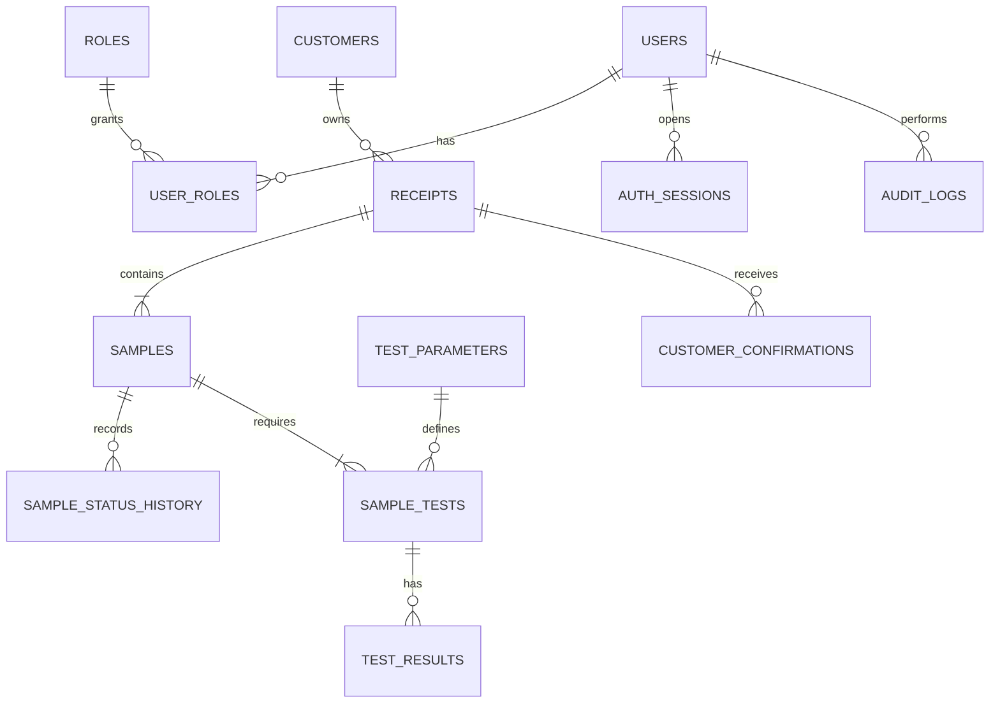

# Mô hình dữ liệu logic sơ bộ

**Phiên bản:** 0.1 · **Trạng thái:** Đề xuất, chưa tạo database/migration

## Lựa chọn cơ sở dữ liệu

MySQL là lựa chọn chính cần đánh giá vì nghiệp vụ quan hệ, transaction, khóa ngoại, tìm kiếm/phân trang và năng lực vận hành phổ biến. PostgreSQL vẫn là phương án thay thế tốt về tính năng SQL và truy vấn; chưa chốt trước khi khảo sát backup/restore, phiên bản được phép vận hành, nhân sự và hạ tầng.

## Thực thể và quan hệ

| Thực thể | Trách nhiệm / khóa nghiệp vụ |
|---|---|
| Users, Roles, User Roles | Tài khoản nhân viên, role; unique username/email theo chính sách |
| Customers | Thông tin khách tối thiểu; không dùng phone làm khóa duy nhất mặc định |
| Receipts | Phiếu tiếp nhận; `receipt_code` duy nhất; một khách có nhiều phiếu |
| Samples | Mẫu cụ thể; `sample_code` duy nhất; một phiếu có nhiều mẫu |
| Sample Status History | Mỗi lần chuyển trạng thái, actor, thời điểm, lý do |
| Test Parameters | Danh mục chỉ tiêu, kiểu dữ liệu, đơn vị/phương pháp phiên bản |
| Sample Tests | Liên kết mẫu–chỉ tiêu–phương pháp và trạng thái xử lý |
| Test Results | Giá trị, đơn vị, LOD/ghi chú, người nhập, phiên bản và trạng thái duyệt |
| Auth Sessions | Refresh/session hash, user, expiry, revokedAt, device metadata tối thiểu |
| Customer Confirmations | Phiên bản nội dung, người xác nhận, thời điểm và bằng chứng |
| Audit Logs | Actor, action, object, before/after phù hợp, timestamp, trace id |

## Nguyên tắc dữ liệu

- Dùng khóa chính kỹ thuật riêng với mã nghiệp vụ; không đưa ID tăng dần vào QR công khai.
- Timestamp nhất quán, lưu UTC ở backend và hiển thị theo timezone đã thống nhất.
- Không xóa vật lý lịch sử nghiệp vụ; dùng trạng thái, version hoặc correction record.
- Index cần cân nhắc cho `receipt_code`, `sample_code`, trạng thái, createdAt, customer và các filter đã cho phép.
- Kết quả nháp/đã duyệt/đã phát hành phải phân biệt; bản đã phát hành bất biến logic.
- Unique constraints và required fields phải được chốt từ mẫu biểu thật của LAB.
- Chưa tạo SQL, migration hoặc schema runtime trong Giai đoạn 0.

## Câu hỏi dữ liệu mở

Mã phiếu/mã mẫu sinh thế nào; một phiếu có nhiều mẫu ra sao; có version chỉ tiêu/phương pháp không; kết quả phát hành từng phần không; thời gian lưu dữ liệu và file PDF bao lâu; quyền xem vùng trồng thuộc ai.
