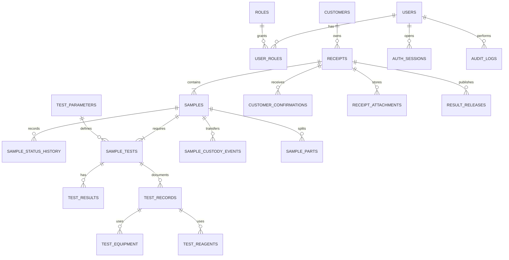

# Mô hình dữ liệu

**Phiên bản:** 0.4 · **Cập nhật:** 13/11/2026 · **Trạng thái:** Auth/user/intake/transfer/testing đã có schema

## Lựa chọn cơ sở dữ liệu

MySQL 8.4 đang được dùng cho profile `mysql`; H2 chạy ở profile mặc định. Schema hiện tạo bằng `db/schema.sql`, backend dùng Hibernate `validate`. Cần chọn Flyway/Liquibase trước production.

## Bảng đã triển khai

`users`, `auth_sessions`, `customers`, `receipts`, `samples`, `receipt_attachments`, `sample_transfers`, `sample_transfer_items`, `testing_records`, `testing_equipment`, `testing_reagents`, `testing_measurements`.

Các bảng status history/custody tổng quát/result release/audit trong ERD mục tiêu dưới đây chưa được triển khai. Custody tối thiểu hiện nằm trực tiếp trên `sample_transfers`.

## Thực thể và quan hệ

| Thực thể | Trách nhiệm / khóa nghiệp vụ |
|---|---|
| Users, Roles, User Roles | Tài khoản nhân viên, role; unique username/email theo chính sách |
| Customers | Thông tin khách tối thiểu; không dùng phone làm khóa duy nhất mặc định |
| Receipts | Phiếu tiếp nhận; `receipt_code` duy nhất; một khách có nhiều phiếu |
| Samples | Mẫu cụ thể; `sample_code` duy nhất; một phiếu có nhiều mẫu |
| Sample Status History | Mỗi lần chuyển trạng thái, actor, thời điểm, lý do |
| Test Parameters | Danh mục chỉ tiêu, kiểu dữ liệu, đơn vị/phương pháp phiên bản |
| Sample Tests | Liên kết mẫu–chỉ tiêu–phương pháp và trạng thái xử lý |
| Test Results | Giá trị, đơn vị, LOD/ghi chú, người nhập, phiên bản và trạng thái duyệt |
| Auth Sessions | Refresh/session hash, user, expiry, revokedAt, device metadata tối thiểu |
| Customer Confirmations | Phiên bản nội dung, người xác nhận, thời điểm và bằng chứng |
| Receipt Attachments | Bản scan/chụp phiếu 3, phiếu 4, file giấy gốc và checksum/version |
| Sample Custody Events | Người giao/nhận, thời điểm, nơi chuyển, tình trạng, lý do và chữ ký/bằng chứng |
| Sample Parts | Các phần vỏ/ruột hoặc nền tách từ mã gốc; hậu tố `-V`, `-R` và liên kết mẫu cha |
| Sample Transfers, Transfer Items | Phiếu 4, actor giao/nhận, hạn kết quả, quyết định nhận/từ chối, thông tin lưu/hoàn và snapshot mẫu bàn giao |
| Test Records | Biên bản 5: thời gian, analyst, checker, công thức, QC, raw data và đánh giá |
| Test Equipment, Test Reagents | Thiết bị/serial/calibration và hóa chất/code/origin/prep/expiry/storage/concentration |
| Result Releases | Phiên bản PDF, người duyệt, thời điểm, checksum, trạng thái thu hồi/đính chính |
| Audit Logs | Actor, action, object, before/after phù hợp, timestamp, trace id |

## Nguyên tắc dữ liệu

- Dùng khóa chính kỹ thuật riêng với mã nghiệp vụ; không đưa ID tăng dần vào QR công khai.
- Timestamp nhất quán, lưu UTC ở backend và hiển thị theo timezone đã thống nhất.
- Không xóa vật lý lịch sử nghiệp vụ; dùng trạng thái, version hoặc correction record.
- Index cần cân nhắc cho `receipt_code`, `sample_code`, trạng thái, createdAt, customer và các filter đã cho phép.
- Kết quả nháp/đã duyệt/đã phát hành phải phân biệt; bản đã phát hành bất biến logic.
- Unique constraints và required fields phải được chốt từ mẫu biểu thật của LAB.
- `sample_code` phải unique toàn hệ thống; không tái sử dụng mã kể cả khi mẫu bị hủy.
- Công thức mã gốc đề xuất: `SOURCE-PRODUCT-DDMMYYYY-SEQUENCE`; mã phần nền thêm `-V`/`-R`; mã QC dùng hậu tố đã quy định trong CFC-TN-14.
- File hồ sơ và PDF phải có checksum/version; không ghi đè bản đã phát hành.
- SQL runtime đã có cho 12 bảng nêu trên; chưa có migration versioned.

## Câu hỏi dữ liệu mở

Mã phiếu/mã mẫu sinh thế nào; một phiếu có nhiều mẫu ra sao; có version chỉ tiêu/phương pháp không; kết quả phát hành từng phần không; thời gian lưu dữ liệu và file PDF bao lâu; quyền xem vùng trồng thuộc ai.
