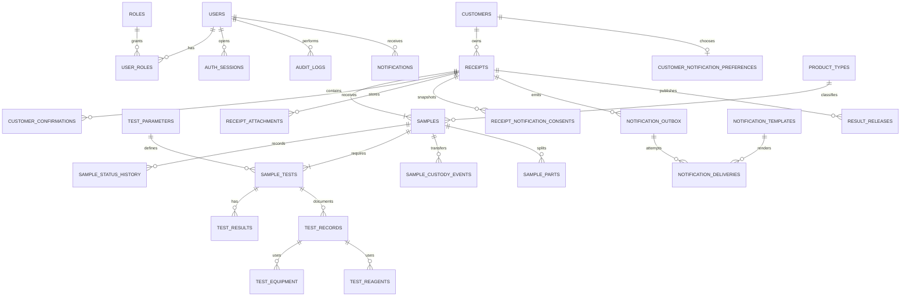

# Mô hình dữ liệu

**Phiên bản:** 0.8 · **Cập nhật:** 14/11/2026 · **Trạng thái:** Phase 1/3 đã nâng schema; notification và coding hardening đang thiết kế

## Lựa chọn cơ sở dữ liệu

MySQL 8.4 là database mặc định cho profile `mysql`; H2 đã được loại khỏi runtime. Flyway chạy migration tự động khi backend khởi động, còn Hibernate dùng `validate` để chỉ kiểm tra entity khớp schema. `db/migration/V1__baseline_schema.sql` là baseline cho schema hiện tại; `db/schema.sql` được giữ làm tài liệu/schema tham chiếu.

## Quy trình migration

- Database `cfc_lab` hiện có chưa có bảng lịch sử Flyway sẽ được baseline tự động ở version `1`, sau đó chạy các migration tương thích `V2`–`V4`; dữ liệu và bảng hiện hữu không bị xóa.
- Database rỗng sẽ được Flyway tạo từ `V1__baseline_schema.sql` khi bấm Run, rồi kiểm tra các migration tương thích `V2`–`V4`.
- Mọi thay đổi schema sau này phải thêm file tăng dần từ `V5`, ví dụ `db/migration/V5__rename_delivered_by.sql`, rồi chỉ cần chạy lại backend. Flyway chỉ chạy mỗi migration một lần và ghi vào `flyway_schema_history`.
- Rename cột, backfill dữ liệu, đổi index, foreign key hoặc stored procedure phải viết SQL tường minh trong migration; không trông chờ Hibernate tự đoán.
- `V2`–`V4` là bản Flyway hóa các script nâng cấp cũ để bổ sung cột/index/backfill còn thiếu trên database đã tồn tại; các file `migration-*.sql` ở thư mục `db/` chỉ giữ để tham chiếu, không chạy lặp lại.
- Không dùng `flyway clean` trên database có dữ liệu; cấu hình hiện tại đã khóa thao tác này.

## Quy ước kiểu chuỗi MySQL

- Dùng `VARCHAR(n)` cho chuỗi có giới hạn và `TEXT` cho nội dung dài; không dùng `NVARCHAR` hoặc `NCHAR`.
- Unicode, bao gồm tiếng Việt, được bảo đảm bằng charset `utf8mb4`, không phải bằng tiền tố kiểu `N` như SQL Server.
- Table nghiệp vụ mặc định khai báo `ENGINE=InnoDB DEFAULT CHARSET=utf8mb4 COLLATE=utf8mb4_unicode_ci`; không phụ thuộc vào default charset/collation của database hoặc máy cài đặt.
- Entity JPA tiếp tục dùng Java `String` và `@Column(length = ...)`; không ép `columnDefinition = "NVARCHAR(...)"`.
- Token, hash, checksum, opaque ID hoặc mã cần phân biệt hoa-thường có thể khai báo `CHAR`/`VARCHAR` với binary collation phù hợp. Ngoại lệ này không thay đổi quy tắc cấm `NVARCHAR`/`NCHAR`.
- Mọi schema/migration mới phải giữ quy tắc trên và được kiểm tra bằng MySQL thật; production phải kiểm tra bằng `Hibernate validate`.

## Bảng đã triển khai

`users`, `auth_sessions`, `customers`, `receipts`, `samples`, `receipt_attachments`, `sample_transfers`, `sample_transfer_items`, `testing_records`, `testing_equipment`, `testing_reagents`, `testing_measurements`.

Các bảng status history/custody tổng quát/result release/audit trong ERD mục tiêu dưới đây chưa được triển khai. Custody tối thiểu hiện nằm trực tiếp trên `sample_transfers`.

Các bảng `customer_notification_preferences`, `receipt_notification_consents`, `notification_templates`, `notification_outbox` và `notification_deliveries` mới là thiết kế Phase 1B, chưa có trong schema runtime. `notifications` (tin nội bộ theo user), `product_types` và `test_parameters` là thiết kế workspace Tiếp nhận I2/I5, cũng chưa có runtime.

Phase 1 bổ sung hồ sơ nguồn trên `receipts` (`sampled_by/at`, vùng trồng, cơ sở đóng gói, xe/moóc/container), metadata phân loại/actor/thời điểm chụp trên `receipt_attachments` và hỗ trợ nhiều dòng `samples`. Phase 3 bổ sung `receiving_department`, `submitted_at` và trạng thái `DRAFT` trên `sample_transfers`.

## Thực thể và quan hệ

| Thực thể | Trách nhiệm / khóa nghiệp vụ |
|---|---|
| Users, Roles, User Roles | Tài khoản nhân viên, role; unique username/email theo chính sách |
| Customers | Thông tin khách tối thiểu; không dùng phone làm khóa duy nhất mặc định |
| Receipts | Phiếu tiếp nhận; `receipt_code` duy nhất; một khách có nhiều phiếu |
| Samples | Mẫu cụ thể; `sample_code` duy nhất; một phiếu có nhiều mẫu |
| Sample Status History | Mỗi lần chuyển trạng thái, actor, thời điểm, lý do |
| Test Parameters | Danh mục chỉ tiêu, kiểu dữ liệu, đơn vị/phương pháp phiên bản |
| Sample Tests | Liên kết mẫu–chỉ tiêu–phương pháp và trạng thái xử lý |
| Test Results | Giá trị, đơn vị, LOD/ghi chú, người nhập, phiên bản và trạng thái duyệt |
| Auth Sessions | Refresh/session hash, user, expiry, revokedAt, device metadata tối thiểu |
| Customer Confirmations | Phiên bản nội dung, người xác nhận, thời điểm và bằng chứng |
| Receipt Attachments | Form 3, ảnh lô/mẫu/bao bì/seal/hư hỏng/nhãn; category, actor upload, thời điểm chụp, metadata và checksum |
| Customer Notification Preferences | Số nhận chuẩn hóa, kênh ưu tiên, consent/opt-out dài hạn, nguồn và thời điểm cập nhật |
| Receipt Notification Consents | Snapshot số nhận, kênh được phép, phiên bản nội dung đồng ý, actor và thời điểm theo từng Phiếu 3 |
| Notification Templates | Mã nghiệp vụ/kênh, provider template ID, version, schema tham số và trạng thái active |
| Notification Outbox | Event giao dịch, aggregate, payload tối thiểu, idempotency key, attempt và lịch retry; ghi cùng transaction Phiếu 3 |
| Notification Deliveries | Kênh/provider, recipient đã mask/hash, provider message ID, trạng thái chuẩn hóa, lỗi và các mốc gửi/giao |
| Notifications | Tin nội bộ theo recipient user; type, message, target, entity, dedupe key, created/read timestamp |
| Product Types | Danh mục tên/code/alias, trạng thái chờ duyệt/active/inactive; Receptionist đề xuất, Admin chuẩn hóa |
| Sample Custody Events | Người giao/nhận, thời điểm, nơi chuyển, tình trạng, lý do và chữ ký/bằng chứng |
| Sample Parts | Các phần vỏ/ruột hoặc nền tách từ mã gốc; hậu tố `-V`, `-R` và liên kết mẫu cha |
| Sample Coding Events | Gán mã, xác minh độc lập, hiệu chỉnh/void; actor, thời điểm, lý do và mã cũ/mới |
| Sample Daily Sequences | Bộ cấp số nguyên tử theo ngày nghiệp vụ; không dùng `COUNT(*) + 1` |
| QC Samples | Mẫu trắng/thêm chuẩn/lặp `BL/SP/D`, liên kết lần thử nghiệm và mẫu nguồn khi có |
| Blind Sample Codes | Bảng đối chiếu mã mù–mã gốc, quyền truy cập riêng và thời điểm mở mù |
| Sample Transfers, Transfer Items | Phiếu 4, actor giao/nhận, hạn kết quả, quyết định nhận/từ chối, thông tin lưu/hoàn và snapshot mẫu bàn giao |
| Test Records | Biên bản 5: thời gian, analyst, checker, công thức, QC, raw data và đánh giá |
| Test Equipment, Test Reagents | Thiết bị/serial/calibration và hóa chất/code/origin/prep/expiry/storage/concentration |
| Result Releases | Phiên bản PDF, người duyệt, thời điểm, checksum, trạng thái thu hồi/đính chính |
| Audit Logs | Actor, action, object, before/after phù hợp, timestamp, trace id |

## Nguyên tắc dữ liệu

- Dùng khóa chính kỹ thuật riêng với mã nghiệp vụ; không đưa ID tăng dần vào QR công khai.
- Timestamp nhất quán, lưu UTC ở backend và hiển thị theo timezone đã thống nhất.
- Không xóa vật lý lịch sử nghiệp vụ; dùng trạng thái, version hoặc correction record.
- Index cần cân nhắc cho `receipt_code`, `sample_code`, trạng thái, createdAt, customer và các filter đã cho phép.
- Kết quả nháp/đã duyệt/đã phát hành phải phân biệt; bản đã phát hành bất biến logic.
- Unique constraints và required fields phải được chốt từ mẫu biểu thật của LAB.
- `sample_code` phải unique toàn hệ thống; không tái sử dụng mã kể cả khi mẫu bị hủy.
- Công thức mã gốc đã chốt: `SOURCE-PRODUCT-DDMMYYYY-SEQUENCE`; mã phần nền thêm `-V`/`-R`; mã QC dùng định danh `BL`, `SP`, `D` cùng ngày/mức nồng độ theo loại QC trong CFC-TN-14.
- CFC-TN-14 đã được xác nhận là nguồn quy tắc chính; dùng `SOURCE-PRODUCT-...`. Phiếu kết quả ví dụ có thứ tự `PRODUCT-SOURCE-...` là sai lệch cần rà soát, không làm thay đổi generator.
- Cấp sequence phải dùng row lock/counter nguyên tử; unique theo mã hoàn chỉnh và ngày + sequence. Ngày trong mã dùng `Asia/Ho_Chi_Minh`, timestamp audit lưu UTC.
- Hồ sơ nguồn cần trường có cấu trúc cho người/ngày lấy mẫu, vùng trồng, cơ sở đóng gói, xe/moóc/container/seal để snapshot sang Phiếu kết quả.
- File hồ sơ và PDF phải có checksum/version; không ghi đè bản đã phát hành.
- SQL runtime đã có cho 12 bảng nêu trên; các thay đổi mới phải đi qua thư mục `db/migration/` và lịch sử Flyway.
- Schema runtime hiện dùng `VARCHAR`/`TEXT`; các table đã triển khai đều khai báo `utf8mb4_unicode_ci`, không có cột `NVARCHAR`.
- Notification dùng unique `idempotency_key`; webhook/callback được xử lý idempotent và không cho sự kiện đến trễ làm lùi trạng thái `DELIVERED`.
- Outbox payload không chứa ảnh/file Phiếu 3, mapping mã mù hoặc kết quả thử nghiệm; secret provider không lưu trong bảng nghiệp vụ. Số điện thoại đầy đủ chỉ tồn tại ở cột cần gửi và phải được mã hóa/giới hạn quyền theo thiết kế production, còn log/UI dùng dạng mask.
- `notifications` không dùng chung với customer delivery: notification nội bộ có `recipient_user_id` và read state, còn ZBS/SMS có consent/provider delivery state. WebSocket chỉ phát sau khi notification nội bộ đã được lưu.
- Loại sản phẩm nhập tay tạo `product_types` ở trạng thái chờ duyệt; product code chính thức do Admin/backend quản lý. Mã mẫu không dùng một mã `OTHER` chung cho mọi sản phẩm mới.

## Câu hỏi dữ liệu mở

Chốt quy tắc số Phiếu kết quả; có version chỉ tiêu/phương pháp không; kết quả phát hành từng phần không; thời gian lưu dữ liệu/PDF bao lâu; ai được xem bảng mã mù và mapping mã–khách hàng.

## Migration V7–V8 — 17/11/2026

- V7: `sample_code_counters` (sequence theo ngày, seed từ `samples`), cột `coding_status/coding_legacy/coded_by/coded_at/verified_by/verified_at` trên `samples` (mẫu cũ → `VERIFIED` + `coding_legacy`), `sample_code_events` (append-only).
- V8: mở rộng `result_releases` (mã tra cứu, số phiếu, mốc gửi/duyệt/phát hành/thu hồi; cột sinh `published_marker` + unique `(testing_record_id, published_marker)` đảm bảo tối đa một bản `PUBLISHED`), `result_release_files` (xóa mềm, checksum, cờ công khai), `result_release_events` (append-only), `public_lookup_audit` (không lưu SĐT/mã/IP thô).
- Đã chạy trên DB trống và DB V6 có dữ liệu cũ (database thử, Docker). **Chưa chạy trên database làm việc**: backup rồi kiểm tra `flyway_schema_history` trước khi áp dụng. Không sửa V1–V8 sau khi đã chạy.
- V9: `result_release_items` (bảng kết quả của phiếu KQKN), `result_releases.quality_head_name/director_name`, `result_release_files.kind` (`UPLOAD`|`GENERATED_REPORT`), `result_number_counters` (số phiếu theo kỳ). Chưa chạy trên database làm việc.
- V12: `test_request_counters(year_code CHAR(2) PK, last_sequence INT)` — bộ đếm số Phiếu yêu cầu `CFC{YY}.{NNNN}` theo năm, cấp bằng `INSERT … ON DUPLICATE KEY UPDATE`; seed từ các số đã có dạng `CFC\d{2}.\d{4,6}`. Số cũ không đúng dạng giữ nguyên. **Chưa chạy trên database làm việc** (backup, kiểm tra `flyway_schema_history` trước).
- V13: checklist theo mẫu Word 07/02 — `sampling_plans` thêm `representative_phone`, `sample_forms` (CSV `WHOLE|FLESH|SKIN`), `lot_size_band` (`LE_1|1_5|5_20|GT_20`), `transport_modes` (CSV `WHOLE_AMBIENT|FRESH_COLD|FROZEN`); `field_sampling_forms` thêm `representative_phone`, `storage_temperature`; bảng mới `field_sampling_items` (mỗi dòng: tên mẫu, phương pháp lấy mẫu, khối lượng, chỉ tiêu CSV `VANG_O|CD|PB|AS`, chỉ tiêu khác). **Chưa chạy trên database làm việc.**
