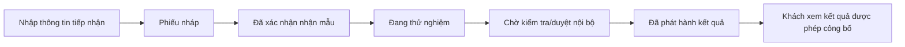

# CFC Lab Management — PRD sơ bộ

**Phiên bản:** 0.2 · **Cập nhật:** 13/11/2026 · **Trạng thái:** Đang triển khai theo vertical slice

## 1. Mục tiêu và phạm vi

CFC Lab Management là hệ thống web giúp LAB quản lý tiếp nhận mẫu, theo dõi tiến độ thử nghiệm và công bố kết quả đã được phép phát hành. Nền tảng auth/Admin và vertical slice phiếu tiếp nhận số 3 đã triển khai; phiếu 4 trở đi chưa có runtime.

**Cập nhật nghiệp vụ 12/11/2026:** Quy trình thực tế được đối chiếu với phiếu tiếp nhận/bàn giao mẫu số 3, phiếu chuyển mẫu số 4, biên bản thử nghiệm số 5, quy trình mã hóa CFC-TN-14 và video `ư.mp4` tại 00:29. Phạm vi ưu tiên được sắp lại thành: tiếp nhận phiếu giấy và số hóa hồ sơ → mã hóa mẫu → chuyển KCS/PTN → lập biên bản thử nghiệm → kiểm tra/duyệt → phát hành PDF → khách tra cứu bằng mã và phần đuôi điện thoại.

### MVP đề xuất (P0)

- Tài khoản nhân viên và RBAC.
- Số hóa phiếu tiếp nhận/bàn giao mẫu giấy và quản lý file hồ sơ gốc.
- Quản lý khách hàng, phiếu tiếp nhận, mẫu, chỉ tiêu và lịch sử bàn giao.
- Sinh mã mẫu theo CFC-TN-14, gồm nguồn/mã khách hàng, loại sản phẩm, ngày nhận, số thứ tự và hậu tố nền V/R.
- Quản lý phiếu chuyển mẫu, biên bản thử nghiệm, thiết bị, hóa chất, QC, raw data và kết quả từng chỉ tiêu.
- Quan hệ một khách hàng — nhiều phiếu; một phiếu — nhiều mẫu.
- Mã phiếu và mã mẫu duy nhất; QR chỉ là kênh truy cập có kiểm soát.
- Trạng thái nội bộ chi tiết; khách chỉ thấy `Đã nhận mẫu → Đang thử nghiệm → Có kết quả`.
- Nhập kết quả ở mức sơ bộ, tách nháp/kiểm tra/phát hành.
- Tra cứu tiến độ; tài liệu nhạy cảm cần lớp xác thực bổ sung.
- Audit log và phiên đăng nhập có thể thu hồi.

### Mở rộng (P1/P2)

Import Excel, vùng trồng và lịch sử nhiều kỳ, dashboard nâng cao, thông báo, PDF nâng cao, tích hợp thiết bị/phần mềm LAB, QR nâng cao.

## 2. Người dùng

| Người dùng | Nhu cầu chính |
|---|---|
| Admin | Quản lý nhân viên, quyền, cấu hình và giám sát |
| Receptionist | Tiếp nhận khách, phiếu và mẫu trong phạm vi được giao |
| Technician | Xem mẫu được giao, cập nhật tiến độ và dữ liệu thử nghiệm theo quyền |
| Khách hàng | Tra cứu tiến độ và xem kết quả đã được phép công bố; không phải role nội bộ |

## 3. Luồng nghiệp vụ đề xuất

“Nhập liệu” là thao tác tạo/cập nhật dữ liệu và chưa đồng nghĩa LAB đã xác nhận mẫu thực tế. `Đã nhận mẫu` chỉ bắt đầu khi nhân viên có thẩm quyền xác nhận việc tiếp nhận hợp lệ, kèm thời điểm và người thực hiện.

## 4. Trạng thái và ngoại lệ

Trạng thái nội bộ đề xuất: `DRAFT`, `RECEIVED`, `IN_TESTING`, `AWAITING_REVIEW`, `APPROVED`, `RELEASED`; có thể thêm `ON_HOLD`, `CANCELLED`, `RETEST_REQUIRED`, `CORRECTION_REQUIRED` sau khi LAB xác nhận.

Kết quả vừa nhập không tự động được công bố. Hủy, tạm dừng, thử lại, sửa sai và đính chính phải có lý do, người thực hiện và lịch sử; quy tắc chính thức vẫn là câu hỏi mở.

## 5. Tra cứu khách hàng và bảo mật

- Mã phiếu/mã mẫu + 3–4 số cuối điện thoại chỉ phù hợp cho tiến độ cơ bản sau khi LAB chấp thuận.
- Dùng token ngẫu nhiên, rate limiting, chống dò mã, thông báo lỗi không phân biệt dữ liệu tồn tại và không đưa số điện thoại đầy đủ vào URL.
- Kết quả/PDF nhạy cảm cần xác thực bằng mã mẫu/mã phiếu + phần đuôi số điện thoại theo chính sách LAB; cần rate limit, chống dò mã và có thể bổ sung OTP/mã truy cập bí mật.
- Chỉ kết quả đã duyệt/phát hành mới được xem hoặc tải PDF; không hiển thị raw data, QC và kết quả nháp cho khách.
- Không lưu access/refresh token nhạy cảm trong localStorage; session refresh phía server phải thu hồi được và có giới hạn tuyệt đối 30 ngày.

## 6. Tiêu chí giai đoạn 0

Có tài liệu nghiệp vụ, RBAC, API conventions, mô hình dữ liệu/ERD, kiến trúc, roadmap và danh sách câu hỏi mở; không có controller, entity, component, migration, dependency hay API runtime mới.

## 7. Open questions ưu tiên cao

1. Ai xác nhận `Đã nhận mẫu`, ai nhập/kiểm tra/duyệt/phát hành kết quả?
2. Một phiếu có bao nhiêu mẫu; có phát hành kết quả từng phần không?
3. Trường bắt buộc, cách sinh mã, trạng thái hủy/thử lại/đính chính là gì?
4. Khách được xem trường nào; có được tải PDF không; cần OTP hay mã bí mật nào?
5. Danh mục chỉ tiêu, phương pháp, đơn vị, KPH/LOD và dữ liệu máy hiện ở đâu?
6. Chính sách lưu trữ, backup/restore, hạ tầng, domain và yêu cầu pháp lý/chất lượng là gì?

Chi tiết đầy đủ được giữ trong kế hoạch gốc đã cập nhật và [DATABASE.md](DATABASE.md), [RBAC.md](RBAC.md), [API_CONVENTIONS.md](API_CONVENTIONS.md).
