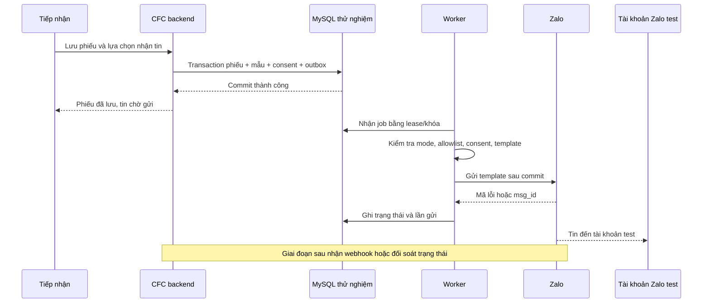

# Kế hoạch thử gửi Zalo khi tiếp nhận mẫu

**Ngày:** 23/11/2026 · **Trạng thái:** Plan, chưa triển khai tích hợp · **Mốc source đã rà:** `101a904`.

Mục tiêu trước mắt là tạo phiếu tiếp nhận bằng dữ liệu thử trên CFC Lab và nhận tin Zalo trên **tài khoản của chính người dùng**. Người dùng xác nhận đã thử gửi theo số điện thoại, bằng template của mình. Kết quả thử đó chưa được xem là đã nghiệm thu gửi cho khách thật.

Kế hoạch này cụ thể hóa phần thử nghiệm Zalo trong [thiết kế thông báo khách hàng](../docs/INTAKE_NOTIFICATIONS.md). SMS và gửi kết quả kiểm nghiệm là giai đoạn sau. Lần lập plan chỉ cập nhật tài liệu; không gửi tin, gọi API bằng credential của người dùng, đổi cấu hình Zalo hoặc đọc/ghi `.env`.

## 1. Phạm vi thử nghiệm đã chốt

- Kênh: ZBS Template Message gửi theo **SĐT**, dưới tên OA; không cần triển khai liên kết UID.
- Người nhận: chỉ SĐT test của chủ tài khoản, cấu hình riêng phía backend.
- Nội dung: xác nhận **đã ghi nhận tiếp nhận mẫu**, có Số/No. phân biệt từng phiếu.
- Đơn vị gửi: **một phiếu tiếp nhận → một sự kiện xác nhận**, kể cả phiếu có nhiều mẫu.
- Một khách có nhiều phiếu: mỗi phiếu có tin và lịch sử riêng; không chặn tin chỉ vì cùng SĐT.
- Bắt đầu bằng provider giả, sau đó mới thử gọi Zalo với dữ liệu giả và số được phép.

Tài liệu Zalo có chế độ `development`, chỉ hỗ trợ gửi thử tới quản trị viên ứng dụng hoặc OA. Adapter test sẽ bắt buộc truyền `mode: "development"` và kiểm tra SĐT trong danh sách cho phép. Cần đối chiếu request đã test thành công để biết lần test trước có dùng chế độ này hay chỉ dùng một template test. [API development mode](https://docs.zaloplatforms.com/docs/ZBS/gui-tin-template-qua-sdt/api-gui-tin-qua-sdt/api-gui-tin-su-dung-development-mode).

## 2. Hiện trạng và điểm tích hợp trong source

| Vị trí | Hiện trạng | Công việc dự kiến |
|---|---|---|
| `source/be/src/main/java/com/example/app/intake/service/ReceiptService.java:161` | `create()` có transaction, lưu khách, phiếu và nhiều mẫu | Ghi consent/snapshot và outbox cùng transaction sau khi lưu phiếu |
| Cùng file, khoảng dòng 238 | Đã tạo `INTAKE_RECORDED` cho nhân viên | Giữ thông báo nhân viên; thêm lời gọi service thông báo khách độc lập |
| `source/be/src/main/java/com/example/app/intake/dto/CreateReceiptRequest.java` | Có SĐT khách, chưa có lựa chọn gửi Zalo | Bổ sung object notification tùy chọn, tương thích request cũ |
| `source/fe/src/features/intake/pages/ReceiptCreatePage.jsx:136` | Tạo phiếu trước, upload ảnh bằng request riêng sau đó | Thêm lựa chọn nhận tin; tin xác nhận không phụ thuộc upload ảnh |
| `source/fe/src/features/intake/pages/ReceiptDetailPage.jsx` | Có hồ sơ, mẫu và ảnh, chưa có lịch sử gửi khách | Hiển thị trạng thái gửi của đúng phiếu |
| `source/fe/src/features/intake/api/intakeApi.js` | API feature dùng HTTP client chung | Thêm API đọc trạng thái và retry có quyền |
| `source/be/src/main/java/com/example/app/config/SecurityConfig.java` | Route tiếp nhận cho ADMIN/RECEPTIONIST; chưa có webhook Zalo | Rule riêng cho retry/Admin và webhook khi đến giai đoạn nhận callback |
| `source/be/src/main/resources/db/migration/` | Đã có V1–V19 | Kiểm tra lại version khi code; dự kiến migration mới từ V20 nếu còn trống |

Hai chi tiết cần giữ đúng khi triển khai:

1. Lưu phiếu thành công không có nghĩa ảnh tải lên thành công. Trigger dự kiến là commit của `ReceiptService.create()`, không phải hoàn tất mọi chứng từ hay KCS chấp nhận mẫu.
2. Khách hiện được tìm bằng `findByPhone(request.customerPhone().trim())`; chưa được coi là cơ chế chuẩn hóa số hoàn chỉnh. Đích gửi phải là snapshot được xác nhận của phiếu, không lấy động từ hồ sơ khách khi worker chạy. Không sửa hoặc gộp khách cũ trong tác vụ này.

## 3. Khách có nhiều đơn được xử lý thế nào

Trong kế hoạch này, “đơn” được đối chiếu bằng **phiếu tiếp nhận và Số/No.**. Không dùng SĐT làm mã đơn.

| Tình huống | Kết quả mong muốn |
|---|---|
| Một khách, một phiếu, ba mẫu | Một tin; số lượng mẫu là 3 |
| Một khách, hai phiếu `CFC26.0001`, `CFC26.0002` | Hai tin, mỗi tin ghi đúng Số/No. |
| Hai phiếu có cùng SĐT nhưng tên đơn vị khác nhau | Hai sự kiện riêng, snapshot nội dung theo từng phiếu |
| Bấm lưu lặp hoặc chạy lại worker cho cùng phiếu | Không tạo thêm sự kiện xác nhận |
| Bổ sung ảnh hoặc sửa dữ liệu không liên quan gửi tin | Không tự gửi lại tin xác nhận |
| Sau này có sự kiện phát hành kết quả | Loại sự kiện mới, có khóa riêng; không ghi đè lịch sử tiếp nhận |

Khóa nghiệp vụ dự kiến: `INTAKE_RECORDED:receiptId`, có unique constraint. Không đưa SĐT, phiên bản template hoặc số lần retry vào khóa này. Đổi template không tự sinh thêm một tin cho phiếu cũ.

Snapshot lưu riêng theo phiếu: số nhận, lựa chọn/đồng ý nhận tin, Số/No., thời điểm tiếp nhận, số lượng mẫu, template ID/version và dữ liệu tham số. Phiếu thứ hai không được ghi đè đích nhận hay nội dung của phiếu thứ nhất. Chưa gộp nhiều đơn thành bản tin tổng hợp.

## 4. Cần chuẩn bị gì

### Để test bằng chính tài khoản của bạn

| Cần có | Cách sử dụng |
|---|---|
| Template ID và danh sách **tên biến thật** của template | Dùng lại template của bạn; mapping chính xác tên, kiểu, giới hạn và trường bắt buộc |
| Request/response test đã thành công, đã bỏ token và số thật | Đối chiếu endpoint, mode, body và mã trả về; không đoán request từ ảnh giao diện |
| OA ID, App ID và quyền quản trị của tài khoản nhận test | Xác nhận đúng cặp App/OA và người nhận hợp lệ cho test |
| Access token còn hiệu lực | Cấp riêng cho backend thử nghiệm qua cơ chế cấu hình an toàn; không đưa vào frontend, chat, plan hoặc Git |
| Một SĐT test có Zalo, cấu hình ngoài source | Backend chuẩn hóa rồi kiểm tra allowlist trước mỗi lần gọi provider |
| Database/dữ liệu phiếu thử độc lập | Tạo hai phiếu khác Số/No. cho ca nhiều đơn; không dùng hồ sơ khách đang vận hành |
| Máy chạy backend có Internet ra Zalo | Đủ để thử gửi outbound; chưa cần công khai toàn bộ CFC Lab |

Ảnh chụp có nhãn “Chưa kích hoạt”. P0 cần đối chiếu trạng thái App đang thực sự dùng trong request test. Chỉ ghi nhận trạng thái và lỗi trả về; chưa tự kích hoạt hay xin thêm quyền khi lập plan.

### Để vận hành cho khách thật sau này

- Xác nhận điều kiện OA/App, liên kết tài khoản ZBS, quyền gửi theo SĐT và trạng thái template dùng thật. Các nhóm quyền gửi API và nhận webhook được Zalo quản lý riêng. [Nhóm quyền ZBS](https://docs.zaloplatforms.com/docs/ZBS/bat-dau/gioi-thieu-ve-cac-nhom-quyen-thuoc-zbs-template-message).
- Chốt mẫu tin tiếp nhận với LAB; xác nhận người nhận được phép, số nhận của khách và cách ghi nhận đồng ý/từ chối. Mẫu đang test chưa mặc nhiên đáp ứng yêu cầu dùng thật.
- Chốt ngân sách, người quản lý tài khoản, số dư và quota. Không giả định test miễn phí hoặc ghi cứng đơn giá; kiểm tra giá của đúng template và cách tính phí khi triển khai. [Chi phí trong hướng dẫn API](https://zalo.solutions/business-message/guidelines/en/gui-api).
- Có cơ chế lưu/làm mới token bền vững, cảnh báo và cấp quyền lại khi cần.
- Có URL HTTPS cho webhook nếu cần xác nhận giao tin tự động; cấu hình proxy chỉ mở đúng route cần thiết.
- LAB chọn người theo dõi lỗi, quy tắc retry, thời hạn lưu lịch sử và quy trình tạm dừng gửi.

## 5. Luồng xử lý đề xuất



- Outbox là bản ghi “cần gửi tin”, được lưu cùng giao dịch tiếp nhận. Rollback thì cả phiếu và sự kiện gửi đều không tồn tại.
- Worker chỉ gọi mạng sau khi job đã được ghi nhận. Không giữ transaction tạo phiếu trong thời gian gọi Zalo; không chỉ dùng callback trong RAM vì có thể mất việc khi backend khởi động lại.
- Gửi lỗi không đảo ngược phiếu đã lưu. UI tách thông báo “lưu phiếu” và “gửi Zalo”.
- Không tự gửi bù cho các phiếu cũ khi bật tính năng; các sự kiện của môi trường test không chuyển sang gửi thật.

## 6. Contract và dữ liệu dự kiến

### API CFC Lab

Các API dưới đây là **đề xuất**, chưa tồn tại.

| API | Quyền và hành vi |
|---|---|
| `POST /api/v1/receipts` | Giữ contract cũ; thêm `customerNotification` tùy chọn. Thiếu object hoặc `enabled=false` thì không gửi |
| `GET /api/v1/receipts/{id}/notification-deliveries?page=0&size=20` | ADMIN/RECEPTIONIST theo quyền hồ sơ; trả trạng thái/từng lần gửi và SĐT đã mask |
| `POST /api/v1/receipts/{id}/notification-deliveries/{deliveryId}/retry` | Chỉ ADMIN, kiểm tra delivery thuộc phiếu; body có `reason`, `requestId` chống bấm lặp |
| `POST /api/v1/webhooks/zbs` | Chỉ thêm ở giai đoạn webhook; xác minh chữ ký, App/OA và dữ liệu trước cập nhật |

Object tạo phiếu dự kiến:

```json
{
  "customerNotification": {
    "enabled": true,
    "recipientPhone": "<SĐT test cấu hình riêng>",
    "consentAccepted": true
  }
}
```

Version nội dung consent, actor và thời điểm được xác định/kiểm tra phía server. Client không được chọn template tùy ý, đổi provider mode hoặc bỏ allowlist.

- Số không hợp lệ hoặc chưa đồng ý trong yêu cầu bật gửi: trả validation rõ trước khi tạo phiếu.
- Số hợp lệ nhưng ngoài allowlist: phiếu vẫn lưu; trạng thái gửi `BLOCKED` với lý do `OUTSIDE_TEST_ALLOWLIST`, không gọi Zalo.
- Retry `ACCEPTED`, `DELIVERED`, `UNKNOWN` hoặc job đang chạy: 409; không phát request gửi thêm. Cùng `requestId` được xử lý idempotent.
- Rule retry/Admin phải đứng trước rule rộng `/receipts/**`; service vẫn kiểm tra role và quan hệ phiếu–delivery. KCS không truy cập thông tin gửi khách.

### Bảng tối thiểu cho các bước thử nghiệm

| Bảng dự kiến | Dữ liệu và ràng buộc |
|---|---|
| `receipt_notification_consents` | Snapshot theo phiếu: đích nhận, đồng ý/từ chối, phiên bản nội dung đồng ý, actor và thời gian |
| `customer_notification_outbox` | `receipt_id`, `event_type`, `event_key` unique; môi trường/mode, snapshot template/payload, trạng thái, thời điểm xử lý tiếp, lease owner/deadline |
| `notification_delivery_attempts` | Outbox FK, số lần thử, `tracking_id` unique, mã provider, `msg_id`, thời điểm, lỗi đã chuẩn hóa và hash request; mỗi lần gọi có bản ghi riêng |

MySQL dùng `utf8mb4`, `VARCHAR/TEXT`; mã đối soát cần collation phù hợp. Index phục vụ `(status, next_attempt_at)` và lịch sử theo phiếu. SĐT cần để gửi được lưu ở vùng dữ liệu có kiểm soát; log và phản hồi danh sách dùng số mask. Không lưu token trong các bảng nghiệp vụ này.

Chưa cần triển khai màn hình quản lý nhiều nhà cung cấp, nhiều template hay sở thích khách toàn hệ thống để nghiệm thu case test. Khi thêm các bảng đó sau này, snapshot của phiếu cũ vẫn giữ nguyên.

### Request Zalo

Adapter dùng `POST https://business.openapi.zalo.me/message/template`, header `access_token`, body có `phone`, `template_id`, `template_data`, `tracking_id`. Chuẩn hóa số Việt Nam về dạng mã quốc gia; tên biến của `template_data` phải lấy từ template của bạn. [API gửi theo SĐT](https://docs.zaloplatforms.com/docs/ZBS/gui-tin-template-qua-sdt/api-gui-tin-qua-sdt/api-gui-tin).

`event_key` chống tạo trùng sự kiện nội bộ. `tracking_id` dùng đối soát lần gọi: ví dụ tiền tố `CFCDEV` + UUID bỏ dấu gạch, không chứa SĐT hay Số/No. có dấu chấm. Giới hạn theo tài liệu provider. Không suy ra rằng Zalo chống gửi trùng chỉ vì dùng lại `tracking_id`.

Nội dung nghiệp vụ dự kiến: “CFC Lab đã ghi nhận phiếu {Số/No.} lúc {thời điểm}, gồm {số mẫu} mẫu”. Đây là nội dung để mapping, không phải khẳng định template hiện tại có những tên biến này. Nếu template chưa có trường phân biệt đơn, cần điều chỉnh template test trước ca hai đơn.

## 7. Trạng thái, retry và token

| Trạng thái | Ý nghĩa trên UI |
|---|---|
| `QUEUED` | Chờ gửi |
| `SENDING` | Đang xử lý |
| `ACCEPTED` | Zalo đã nhận yêu cầu; chưa xác nhận tin đến thiết bị |
| `DELIVERED` | Đã có bằng chứng giao tới thiết bị |
| `RETRY_WAIT` | Có lỗi được phép thử lại, đang chờ |
| `UNKNOWN` | Không xác định Zalo đã nhận request hay chưa; cần đối soát |
| `BLOCKED` | Không đủ điều kiện gửi, ví dụ ngoài allowlist |
| `FAILED_FINAL` / `CANCELLED` | Lỗi không tự thử tiếp / đã hủy |

HTTP 200 chưa đủ kết luận thành công; adapter phải đọc `error` và `msg_id`. Thành công của API không đồng nghĩa khách đã đọc tin. Trạng thái giao có thể đối soát qua API riêng bằng `message_id`; API này không được giả định tìm được tin chỉ bằng `tracking_id` khi chưa có `msg_id`. [API trạng thái](https://docs.zaloplatforms.com/docs/ZBS/gui-tin-template-qua-sdt/api-truy-xuat-thong-tin-gui-tin-qua-sdt/api-lay-thong-tin-trang-thai-gui-tin-qua-sdt).

Quy tắc triển khai:

- Provider giả dùng để kiểm tra retry, lỗi mạng, concurrency và backoff. Giai đoạn test Zalo thật mặc định một lần gọi mỗi sự kiện, không tự chạy retry hàng loạt.
- Timeout sau khi có thể đã gửi request, HTTP 5xx không rõ kết quả, hoặc worker chết khi đang gửi → `UNKNOWN`; không tự POST lại. Chờ callback, đối soát có đủ dữ liệu hoặc xác minh thủ công.
- Với lỗi được provider xác nhận chưa nhận tin, phân loại theo tài liệu: thiếu tham số/template hoặc không có quyền phải sửa cấu hình; người nhận từ chối không tự gửi tiếp; hết quota chờ điều kiện phục hồi. Không gom mọi 4xx/5xx vào cùng chính sách. [Mã lỗi ZBS](https://docs.zaloplatforms.com/docs/ZBS/bang-ma-loi).
- Nhận job bằng thao tác atomic có lease. Hai worker không cùng gửi một attempt; lease hết sau khi có khả năng đã gọi mạng phải chuyển đối soát, không mặc định gửi lại.
- Không hứa exactly-once với hệ thống bên ngoài. Unique key chống trùng nội bộ; tình huống mất phản hồi cần xử lý riêng.

Đối với token: buổi test ngắn có thể dùng access token còn hiệu lực do người quản trị cấp. Trước vận hành dài hạn cần tự refresh, đọc `expires_in`, khóa refresh theo App/OA và lưu cặp token mới nguyên tử. Refresh token của Zalo chỉ dùng một lần; tài liệu hiện ghi access token 25 giờ, refresh token 3 tháng. [OAuth Zalo](https://docs.zaloplatforms.com/docs/OA/bat-dau/xac-thuc-va-uy-quyen-cho-ung-dung-new).

Kho token dài hạn cần mã hóa hoặc secret store có khả năng cập nhật, key tách khỏi dữ liệu và backup. Không ghi token mới trở lại `.env`; không để nhiều tiến trình/script cùng refresh. Nếu mất kết quả refresh hoặc không lưu được token mới, cảnh báo và yêu cầu cấp quyền lại thay vì thử mù.

## 8. Các bước thực hiện

### P0 — Chốt cấu hình test đang hoạt động

- [ ] Nhận template ID, tên biến/kiểu/giới hạn và request test đã bỏ thông tin nhạy cảm.
- [ ] Xác nhận SĐT của bạn có vai trò quản trị phù hợp; xác nhận mode và App/OA thực dùng.
- [ ] Chốt mapping: Số/No., thời gian nghiệp vụ `Asia/Ho_Chi_Minh`, số lượng mẫu và lời xác nhận.
- [ ] Chọn database, tài khoản CFC thử nghiệm và nguồn credential riêng; kiểm tra Git, giữ file người dùng.

**Đạt khi:** có bảng mapping đầy đủ và một trường xác định đơn trong template; chưa cần gửi thêm tin để lập plan.

### P1 — Tạo case test với provider giả

- [ ] Thêm schema, DTO tùy chọn, consent snapshot và service ghi outbox trong transaction tiếp nhận.
- [ ] Thêm provider interface, fake provider, worker, unique key và lịch sử attempt.
- [ ] Thêm UI chọn nhận tin, hiển thị số nhận và trạng thái trên kết quả tạo phiếu/chi tiết phiếu.
- [ ] Hoàn thành test rollback, hai phiếu cùng khách, nhiều mẫu, request lặp và đồng thời.

**Đạt khi:** có hai phiếu cùng khách → hai sự kiện; cùng một phiếu chạy lặp không thêm tin. Chưa có request gửi đến Zalo thật.

### P2 — Nối Zalo và thử với tài khoản của bạn

- [ ] Thêm `ZaloTemplateProvider`, validate mapping, timeout, đọc lỗi nghiệp vụ trong JSON.
- [ ] Mode server có `OFF`, `FAKE`, `ZALO_DEVELOPMENT`; mặc định `OFF`. Khi chọn mode Zalo test, allowlist rỗng làm cấu hình gửi không hợp lệ, không được hiểu là cho phép mọi số.
- [ ] Kiểm tra allowlist sau chuẩn hóa và ngay trước mỗi lần gửi; adapter bắt buộc mode thử nghiệm. Không tự thay đích nhận của hồ sơ thật thành số test.
- [ ] Bạn cấp token cho backend riêng; bắt đầu bằng một phiếu, sau đó hai phiếu khác Số/No. trên cùng số nhận.
- [ ] Ghi trạng thái nhận API và đối chiếu tin đến app Zalo; bằng chứng thực tế được đánh dấu kiểm tra thủ công nếu chưa có callback/API trạng thái.
- [ ] Đề xuất giới hạn 5 lần gọi thật/đợt test, tính cả retry; cần chỉnh con số theo quota/buổi test thực tế.

**Đạt khi:** bạn nhận đúng hai tin của hai phiếu; số khác không phát request. Tắt mode gửi là dừng việc lấy job mới và không tự gửi bù phiếu cũ.

### P3 — Theo dõi trạng thái tự động trong môi trường test

- [ ] Dùng API trạng thái cho các attempt có `msg_id`, lưu bằng chứng và thời điểm đối soát; không bật polling vô hạn.
- [ ] Nếu cần thử webhook: tạo một URL HTTPS/tunnel test chỉ mở `POST /api/v1/webhooks/zbs`. `localhost`/IP LAN không phải callback công khai.
- [ ] Xác minh `X-ZEvent-Signature` theo raw body và thuật toán trong tài liệu đúng loại webhook; kiểm tra App/OA, đối chiếu `msg_id`/`tracking_id`, không serialize lại JSON trước khi tính chữ ký. Khóa dùng xác minh webhook phải được đối chiếu riêng, không mặc định giống App Secret.
- [ ] Lưu và chống trùng sự kiện trước khi trả 2xx; callback trùng không tạo lại tin, callback đến sớm được lưu chờ khớp. Callback muộn không hạ trạng thái đã giao và không làm lùi trạng thái attempt mới.
- [ ] Rule public và CSRF ngoại lệ chỉ áp dụng route webhook; bảo vệ các API quản trị như trước. Thử cả trường hợp cookie cũ/không có cookie ở webhook.

Sự kiện cần nhận là `user_received_message`; `delivery_time` là thời điểm thiết bị nhận, không phải thời điểm server CFC nhận callback. [Webhook theo SĐT](https://docs.zaloplatforms.com/docs/ZBS/gui-tin-template-qua-sdt/webhook-gui-tin-qua-sdt/su-kien-nguoi-dung-nhan-tin-qua-sdt).

**Đạt khi:** trạng thái tự cập nhật từ bằng chứng provider; không hiển thị “Đã nhận/đã đọc” chỉ từ HTTP 200 của lệnh gửi.

### P4 — Chuẩn bị gửi khách thật sau khi test đạt

- [ ] LAB chốt điều kiện tài khoản/template, người nhận, nội dung và ngân sách nêu ở mục 4.
- [ ] Triển khai token refresh bền vững, cảnh báo token/quota, retry theo mã lỗi và đối soát `UNKNOWN`.
- [ ] Bổ sung màn hình lỗi, audit retry, chính sách lưu dữ liệu và quy trình tạm dừng; ghi runbook Linux/Windows đúng môi trường dùng thật.
- [ ] Mở mode gửi thật bằng cấu hình/đợt triển khai riêng; không chỉ bỏ allowlist trên adapter test. Dữ liệu/queue test không được phát lại sang production.
- [ ] Pilot nhóm khách được phép, kiểm tra thời gian giao/số tin/chi phí, rồi mới mở rộng.
- [ ] Khi cần gửi thông báo kết quả: thêm event `RESULT_PUBLISHED` theo hồ sơ/phiên bản, template riêng và link HTTPS tra cứu đã nghiệm thu. SMS dự phòng có provider và kế hoạch riêng.

## 9. File dự kiến khi bắt đầu code

| Phạm vi | File/package dự kiến |
|---|---|
| Điểm phát sự kiện | Sửa `intake/service/ReceiptService.java`, `intake/dto/CreateReceiptRequest.java`; giữ constructor tương thích cho caller/test cũ khi cần |
| Feature thông báo khách | Thêm dưới `notification/customer/{controller,dto,entity,repository,service,provider}`; không tái sử dụng entity thông báo nhân viên làm hàng đợi gửi Zalo |
| Gửi và xử lý nền | `IntakeCustomerNotificationService`, `CustomerNotificationWorker`, `CustomerMessageProvider`, `FakeCustomerMessageProvider`, `ZaloTemplateProvider` |
| Giai đoạn token/webhook | `ZaloTokenService`, kho token được bảo vệ và webhook handler theo stage tương ứng |
| Security/schema/config | `config/SecurityConfig.java`, migration mới; chỉ thêm khai báo cấu hình không chứa giá trị bí mật |
| UI | `ReceiptCreatePage.jsx`, `ReceiptDetailPage.jsx`, `intakeApi.js`, component lịch sử gửi trong feature intake |
| Kiểm thử | Test service/outbox/worker/adapter, integration MySQL, API RBAC và UI giả lập; lần gửi Zalo thật tách khỏi suite tự động |

Các tên class mới là đề xuất. Đọc lại source và dùng CodeGraph trước khi code; không sửa nghiệp vụ ngoài tiếp nhận/thông báo khách để hoàn thành tính năng này.

## 10. Ma trận nghiệm thu

| Ca | Kỳ vọng | Cách thử |
|---|---|---|
| T01: Một phiếu có nhiều mẫu | Một event/tin, đúng số mẫu | Fake; sau đó một lần Zalo test |
| T02: Hai phiếu cùng khách/SĐT | Hai event, hai Số/No., nội dung đúng từng phiếu | Fake + tài khoản Zalo của bạn |
| T03: Cùng phiếu bị xử lý lặp | Một event; không gửi thêm do retry HTTP/client | Unique constraint + integration |
| T04: Giao dịch tiếp nhận rollback | Không outbox, không attempt gửi | Integration |
| T05: Tạo phiếu được nhưng upload ảnh lỗi | Tin chỉ xác nhận ghi nhận, không gửi lại khi bổ sung ảnh | UI/backend giả lập |
| T06: SĐT ngoài allowlist hoặc allowlist trống | Không request mạng đến Zalo | Mock HTTP server; không gửi thử đến người khác |
| T07: Số 0..., 84..., +84... | Cùng dạng chuẩn để so allowlist; số sai bị báo lỗi | Unit |
| T08: Template thiếu/sai biến, `error != 0` trong HTTP 200 | Hiển thị lỗi, không báo đã giao | Mock provider |
| T09: Token hết hạn/quota hết/người nhận từ chối | Phân loại đúng, phiếu vẫn tồn tại | Mock; chưa dùng hết quota thật để test |
| T10: Timeout sau khi gửi request | UNKNOWN, không tự POST lại | Mock provider |
| T11: Hai worker hoặc restart khi đang gửi | Chỉ một attempt đang chạy; trạng thái mơ hồ phải đối soát | Integration/concurrency |
| T12: Không bật nhận tin hoặc không có object mới | Tương thích luồng tạo phiếu cũ; không gửi | API regression |
| T13: Retry khác phiếu/role KCS/người chưa đăng nhập | 404/403/401 đúng contract, không rò nội dung | API security |
| T14: Callback giả, trùng, đến sớm, đến muộn | Không giả trạng thái giao, không làm lùi trạng thái, không gửi lại | Test chữ ký và inbox |
| T15: Phiếu sau đổi thông tin liên hệ/template | Snapshot phiếu trước giữ nguyên | Integration |
| T16: Tắt gửi/bật lại, dữ liệu test còn trong queue | Không backfill lịch sử, không chuyển test sang thật | Integration + runbook |
| T17: UI loading/error/empty, số mask, bàn phím | Đọc được trạng thái, không tràn ngang | Chrome/Playwright 390/1024/1440/2560 |

Kiểm tra triển khai dự kiến: `bash scripts/run-be-tests-docker.sh` với DB/Redis cô lập; frontend `npm run build` trong `source/fe`; E2E receipt dùng dữ liệu thử. CI chỉ dùng fake/mock provider. Có thể gửi thử Zalo chỉ trong buổi test đã được giao rõ, đúng allowlist và hạn mức; không biến unit/integration test thành thao tác phát tin thật.

## 11. Điểm còn cần dữ liệu trước khi code adapter thật

1. Template ID và tên biến thực tế; template có trường phân biệt Số/No. hay chưa.
2. Request đã thành công dùng `mode: development` hay template test theo cách khác.
3. Nguồn cấp token an toàn cho backend test; App/OA tương ứng và quyền của tài khoản nhận.
4. Muốn dừng ở nhận tin thủ công P2 hay thêm theo dõi tự động P3 ngay đợt đầu.

Có thể bắt đầu P1 bằng fake provider khi chưa có các thông tin này. Chúng chỉ chặn mapping và buổi gửi Zalo thật; không cần người dùng gửi secret vào chat.
